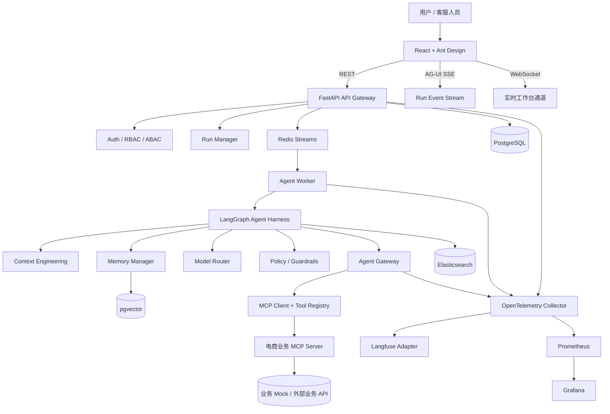
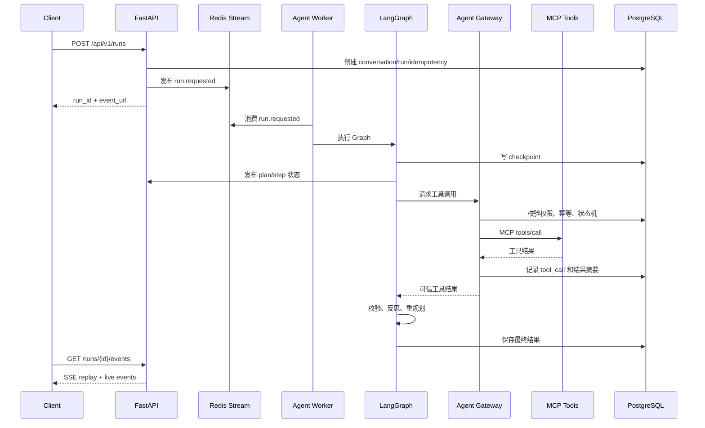
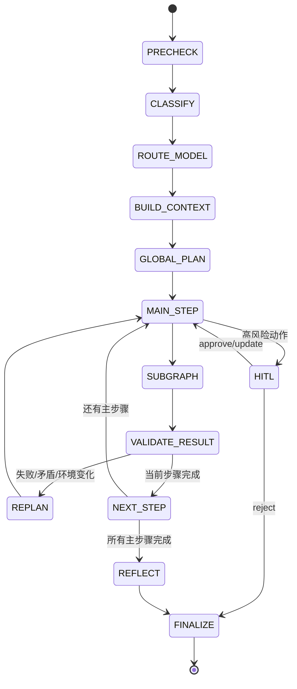

# 电商 L4 智能客服 Agent：总体架构设计

版本：步骤 2 / 2026-10-09  
状态：历史步骤 2 设计；本轮复审内容以 v2 为准

> 2026-10-09 用户要求全面复审 Agent 核心与技术选型。当前审查入口是 [技术复审](../research/2026-10-09-agent-core-review.md) 和 [核心设计 v2](agent-core-v2.md)。本文保留原步骤设计以便追溯，不能直接作为当前实现依据。v2 替换以下旧假设：Run/Redis 双写改为 transactional Outbox；自定义小写事件必须映射官方 AG-UI；状态需要必填字段、预算与稳定 operation_id；HITL 绑定参数/业务/政策版本；记忆不能代替当前业务事实；MVP WS 后置；认证采用共享 session。当前脚手架尚未实现完整业务与 Agent。

## 1. 设计目标

系统面向电商售前、订单、物流、售后和投诉场景，提供单 Agent 的复杂任务规划、工具路由、执行恢复、人工审批、可观测和评测闭环。

MVP 的可靠性目标是：

- Agent 执行状态可持久化、可回放、可恢复。
- 所有业务写操作经过网关、幂等检查和状态机约束。
- 前端可以观察计划、步骤、工具调用、等待审批和最终结果。
- 业务事实来自数据库或工具结果，模型不能自行伪造。
- Agent 的中间过程以结构化事件呈现，不暴露原始思维链。
- API、Worker、工具服务可独立扩展。

## 2. 逻辑分层



## 3. 可部署组件边界

### web

- React、TypeScript、Ant Design。
- 只负责展示和用户交互，不持有模型密钥。
- 通过 REST 查询资源，通过 SSE 接收 Agent 事件。
- 通过 REST 提交人工审批，通过 WebSocket 接收客服工作台状态。

### api

FastAPI 无状态 API 服务，负责登录、Token 刷新、会话、消息、Run、Plan、Trace 查询，创建 Agent Run，SSE 事件订阅，HITL 审批和恢复，评测管理，分页、限流、审计和健康检查。

### worker

- Redis Streams Consumer Group 的消费者。
- 加载 LangGraph 图并执行 Run。
- 将状态变化写入 PostgreSQL。
- 将结构化事件写入 `agent_events` 并发布到事件流。
- 处理超时、重试、模型降级和优雅退出。

### agent gateway

所有工具调用的唯一入口，负责工具注册和版本快照、RBAC/ABAC 授权、风险等级判断、参数 Schema 校验、Prompt Injection 和外部内容信任边界处理、幂等键和状态机校验、超时重试熔断降级以及工具调用审计。

### ecommerce MCP server

首版提供可重复运行的 Mock 电商工具，工具契约与未来真实业务 API 分离。每个工具都声明 `name`、`description`、`inputSchema`、`riskLevel`、`sideEffect`、`requiredScopes`、`idempotent`、`timeoutMs` 和 `version`。

### 数据组件

- PostgreSQL：事实数据、状态、LangGraph Checkpoint、Trace 元数据、评测结果。
- Elasticsearch：商品、政策、FAQ、售后规则和案例检索。
- pgvector：用户语义记忆和 Agent Workflow Memory。
- Redis：队列、锁、缓存、限流、Token 撤销和短期事件广播。

## 4. 业务执行闭环



高风险工具在执行前触发 `interrupt()`：保存 checkpoint，写入 `approval_requests`，发布 `approval.requested`，前端展示审批卡片，REST 提交 approve/reject/update，再用 `Command(resume=...)` 恢复原 Run。

## 5. LangGraph 状态和节点

```python
class AgentState(TypedDict, total=False):
    run_id: str
    tenant_id: str
    conversation_id: str
    user_id: str
    input_text: str
    intent: str
    risk_level: str
    constraints: dict[str, Any]
    plan: dict[str, Any]
    current_node_id: str | None
    messages: list[dict[str, Any]]
    context_refs: list[dict[str, Any]]
    tool_registry_snapshot: dict[str, Any]
    tool_calls: list[dict[str, Any]]
    observations: list[dict[str, Any]]
    errors: list[dict[str, Any]]
    approvals: list[dict[str, Any]]
    replan_count: int
    compaction_version: int
    reasoning_summary: list[str]
    final_answer: str | None
    status: str
    trace_id: str
```

`reasoning_summary` 只保存面向用户和审计的结构化摘要，不保存原始 Chain-of-Thought。



| 节点 | 职责 |
|---|---|
| `precheck` | 输入规范化、敏感信息识别、会话状态检查、幂等检查 |
| `classify` | 意图、风险、复杂度和工具需求分类 |
| `route_model` | 按规则、分类器和降级链选择模型 |
| `build_context` | 加载固定区、滑动区、记忆和检索结果 |
| `global_plan` | 生成受约束的主任务计划 |
| `main_step` | 选择当前主步骤并检查前置条件 |
| `subgraph` | 在主步骤内运行受控 ReAct 工具循环 |
| `validate_result` | 检查工具结果、业务规则和事实一致性 |
| `replan` | 根据错误、矛盾或环境变化修改后续计划 |
| `reflect` | 对任务完成度、工具轨迹和风险进行结构化反思 |
| `finalize` | 生成回答、写入记忆、发布完成事件 |

## 6. PostgreSQL 核心数据模型

核心表：

- `tenants`: `id UUID PK`, `name`, `status`, `created_at`
- `users`: `id UUID PK`, `tenant_id FK`, `username UNIQUE(tenant_id, username)`, `password_hash`, `status`, `created_at`
- `roles`, `permissions`, `user_roles`: RBAC 关系，ABAC 条件存储在 Casbin policy 或策略表。
- `conversations`: `id`, `tenant_id`, `user_id`, `title`, `status`, `last_run_id`, `created_at`, `updated_at`
- `messages`: `id`, `conversation_id`, `run_id`, `role`, `content_redacted`, `content_hash`, `sequence_no`, `created_at`
- `agent_runs`: `id`, `conversation_id`, `tenant_id`, `user_id`, `status`, `input_text_redacted`, `intent`, `risk_level`, `model_provider`, `model_name`, `plan_version`, `replan_count`, `trace_id`, `started_at`, `completed_at`, `error_code`
- `agent_steps`: `id`, `run_id`, `node_id`, `step_type`, `status`, `attempt`, `input_ref`, `output_summary`, `started_at`, `completed_at`
- `tool_calls`: `id`, `run_id`, `step_id`, `tool_name`, `tool_version`, `risk_level`, `idempotency_key`, `request_hash`, `arguments_redacted`, `result_summary`, `status`, `error_code`, `started_at`, `completed_at`
- `agent_events`: `id`, `run_id`, `seq BIGINT`, `event_type`, `payload JSONB`, `trace_id`, `created_at`，唯一约束 `(run_id, seq)`。
- `approval_requests`: `id`, `run_id`, `tool_call_id`, `status`, `requested_action`, `risk_reason`, `reviewer_id`, `review_comment`, `expires_at`
- `idempotency_keys`: `tenant_id`, `key`, `request_hash`, `resource_type`, `resource_id`, `status`, `expires_at`，主键 `(tenant_id, key)`。
- `outbox_events`: `id`, `aggregate_type`, `aggregate_id`, `event_type`, `payload JSONB`, `status`, `attempts`, `next_retry_at`, `published_at`
- `memories`: `id`, `tenant_id`, `user_id`, `memory_type`, `content`, `embedding VECTOR`, `source_run_id`, `confidence`, `expires_at`, `content_hash`
- `eval_datasets`, `eval_cases`, `eval_runs`, `eval_scores`, `eval_artifacts`

## 7. MCP 工具契约

统一调用信封：

```json
{
  "request_id": "req_01J...",
  "trace_id": "tr_01J...",
  "tenant_id": "tenant_demo",
  "actor": {"user_id": "user_01J...", "roles": ["customer"]},
  "idempotency_key": "refund:order_10001:attempt_1",
  "expected_state": "eligible",
  "arguments": {}
}
```

| 工具 | 用途 | 风险 | 副作用 |
|---|---|---:|---:|
| `search_products` | 商品检索 | L0 | 否 |
| `get_product_detail` | 商品详情 | L0 | 否 |
| `search_policy` | 政策和 FAQ 检索 | L0 | 否 |
| `get_order` | 查询订单 | L1 | 否 |
| `get_logistics` | 查询物流 | L1 | 否 |
| `get_coupon` | 查询优惠券 | L1 | 否 |
| `check_refund_eligibility` | 判断退款资格 | L1 | 否 |
| `create_refund_request` | 创建退款申请 | L3 | 是，必须 HITL |
| `escalate_to_human` | 转人工 | L2 | 是 |

写工具规则：`create_refund_request` 必须要求 `idempotency_key`；所有写工具声明允许的前置状态和目标状态；工具不得接收未经网关脱敏的隐私字段；工具结果返回 `source`、`retrieved_at`、`data_version`；工具错误使用稳定 `error_code`。

## 8. AG-UI 事件协议

```json
{
  "event_id": "evt_01J...",
  "run_id": "run_01J...",
  "seq": 17,
  "type": "tool.call.completed",
  "ts": "2026-10-09T10:00:00+08:00",
  "trace_id": "tr_01J...",
  "replayable": true,
  "payload": {}
}
```

事件：`run.started`、`plan.created`、`step.started`、`step.completed`、`tool.call.started`、`tool.call.completed`、`tool.call.failed`、`replan.started`、`replan.completed`、`approval.requested`、`approval.resolved`、`message.delta`、`run.completed`、`run.failed`。

接口：

```text
POST /api/v1/runs
GET  /api/v1/runs/{run_id}
GET  /api/v1/runs/{run_id}/events?after_seq=0
POST /api/v1/runs/{run_id}/approvals/{approval_id}
WS   /api/v1/ws/runs/{run_id}
```

SSE 断线后使用 `after_seq` 回放，避免只依赖内存 Pub/Sub。

## 9. 幂等、重试和故障恢复

- `run_id` 是全局唯一执行标识；相同业务请求必须携带 `idempotency_key`。
- 同一个 Run 使用分布式锁，防止重复 Worker 同时执行。
- Worker 崩溃后从 LangGraph Checkpoint 恢复。
- 读工具可有限重试；写工具使用幂等键和业务状态机。
- 未知写结果不盲目重试，先查询业务状态。
- 模型连接超时、429、5xx 使用指数退避，连续失败触发降级。
- PostgreSQL Outbox 保证业务提交和事件记录在同一事务。
- Redis/Kafka 消费者采用至少一次语义，消费处理以唯一键和状态机保证业务幂等。

## 10. 高可用边界

MVP Docker Compose 提供 API 无状态设计、Worker 多副本、组件健康检查、Run checkpoint 恢复、Outbox 重试、模型降级、SSE 事件回放、优雅关闭和未完成 Run 恢复。

MVP 不宣称单机 Compose 具备真正多机高可用。Kubernetes、PostgreSQL HA、Redis Sentinel/Cluster、Kafka 多副本和跨可用区部署属于升级阶段。

## 11. API 资源边界

```text
/api/v1/auth/*
/api/v1/users/*
/api/v1/conversations/*
/api/v1/runs/*
/api/v1/approvals/*
/api/v1/tools/*
/api/v1/memories/*
/api/v1/knowledge/*
/api/v1/evals/*
/api/v1/health/*
/api/v1/metrics
```

API 层不直接暴露模型供应商密钥、MCP Server 内部地址、原始系统提示词、原始思维链或未脱敏的工具参数和响应。

## 12. 依据与参考

- [LangGraph Persistence and Checkpoints](https://langchain-ai.github.io/langgraph/concepts/durable_execution/)
- [FastAPI Server-Sent Events](https://fastapi.tiangolo.com/tutorial/server-sent-events/)
- [FastAPI OpenTelemetry](https://fastapi.tiangolo.com/advanced/opentelemetry/)
- [Elasticsearch Hybrid Search](https://www.elastic.co/docs/solutions/search/hybrid-search)
- [Apache Kafka Delivery Semantics](https://kafka.apache.org/40/design/design/)
- [FastAPI OAuth2/JWT](https://fastapi.tiangolo.com/tutorial/security/oauth2-jwt/)
- [PyCasbin RBAC/ABAC](https://github.com/pycasbin/casbin)
- [Langfuse Observability](https://langfuse.com/docs/observability/overview)
- [AG-UI Protocol](https://github.com/ag-ui-protocol/ag-ui)
- [Model Context Protocol Server Primitives](https://modelcontextprotocol.io/specification/draft/server/index)
