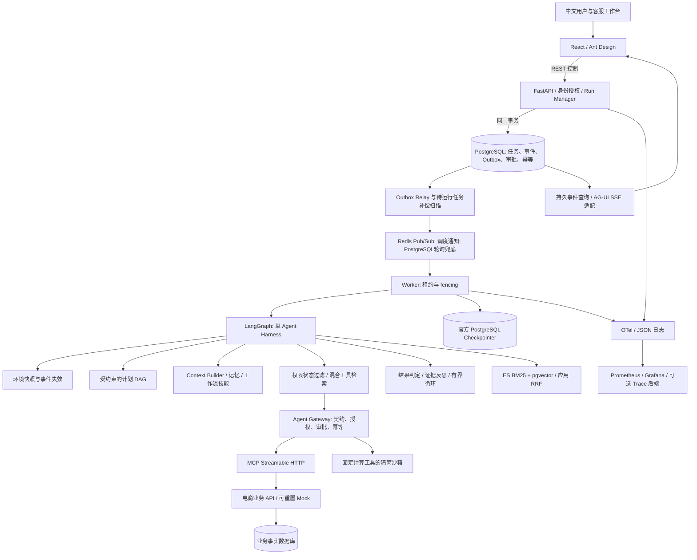
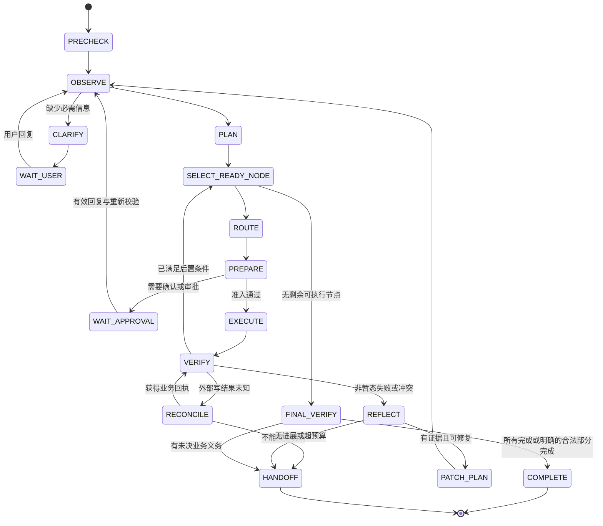

# 单 Agent 核心执行设计 v2

状态：2026-10-09 复审方向已确认，分步实施中。当前步骤7实现边界见 [安全与沙箱](step7-security-sandbox.md)，步骤6见 [记忆与上下文](step6-context-memory.md)，步骤5证据见 [业务交付](../delivery/step5-business-gateway-review.md)，步骤3证据见 [基础设施交付](../delivery/step3-infrastructure-review.md)。本文是总体设计目标，未实现能力以各步交付边界为准；对原 [步骤2](README.md) 的执行、事件、记忆和认证设计具有优先级。依据见 [调研复审](../research/2026-10-09-agent-core-review.md)，测量方法见 [评测协议](../evaluation/benchmark-protocol.md)。

## 1. 边界与组件

一个用户任务由一个有状态的决策 Agent 承担。Planner、Router、Verifier、Reflection 是同一 Harness 的模块/节点；局部业务子图不是独立自主 Agent。检索器、数据库、规则计算器、沙箱工具和离线评测 Judge 不参与多 Agent 协商。

逻辑组件可在 MVP 同一后端镜像内作为独立进程部署。API/Worker/Gateway/MCP 的接口边界保留，不因“微服务”标签拆出大量无业务收益的服务。不可将模型密钥传入前端或 sandbox；身份从可信请求上下文注入，禁止模型覆盖。

## 2. 环境实时感知：事件用于发现变化，读写契约保证正确

“环境”指订单、履约、库存、支付/退款、政策、身份授权、用户新消息、审批、工具/模型健康和执行预算。MVP 不做无授权桌面监控或网页视觉自动操作。

`ObservationEnvelope` 至少包含：`source`、`entity_type/entity_id`、`entity_version`、`observed_at`、`effective_at`、`expires_at`、`schema_version`、`evidence_ref`、`trust_class`、`fields`。业务 API 的结构化字段经 schema 与身份校验后可用于业务判断；其中商品描述、备注、附件及检索文本仍是不可信内容。工具返回一段“已退款”文字不是成功证明。

事件包括订单发货、库存变化、退款完成、政策发布、权限撤销、用户修改目标。MVP Mock 与平台内部采用事务 Outbox；外部业务系统后续可接 webhook/CDC。必须校验签名、event_id、实体版本、去重和乱序；工具目录变更亦用版本快照。只订阅当前任务相关实体，事件突发去抖合并。

执行前过程：

1. 检查引用的实体/政策是否过期或被事件标记失效；只刷新受影响快照。
2. 重新评估可用动作、权限、预算与已完成步骤，构建下次模型上下文。
3. 写操作调用业务 API，携带 `expected_version`、稳定 `operation_id`、审批证明引用。服务端在同一事务/原子条件更新中核验。
4. 若状态改变，返回 `STALE_STATE`；计划失效对应分支，禁止自动绕过新条件。

TTL 只影响读缓存，不能消除读写间竞争。金额、订单状态、权限与审批的安全性来自写入时校验；ES、Redis、向量记忆和模型均不能裁定当前订单可退款。写前 policy version 与授权也需重核验；政策变更按明确的“新请求生效/已批准请求保留或撤销”业务规则处理，不能由 LLM 自选。

事件延迟、快照年龄、失效后刷新耗时需要可观测。首版“本地事件到 Agent 已感知 P95 ≤2 秒”为待测目标，不能外推成第三方物流实时 SLA；写成功即读取确认/查询 operation 状态，不靠睡眠等待。

## 3. 任务理解与可执行计划

先抽取 `TaskSpec`：目标、订单与商品实体、数量/金额/币种、约束、条件分支、用户确认状态、缺失字段、交付验收条件。明确区分用户诉求、权威政策与外部文本；用户说“主管批准了”不能生成真实审批。

规划分四层：

- 可确定规则匹配业务骨架：身份核验 → 事实/政策查询 → 资格校验 → 试算 → 确认/审批 → 写入 → 对账 → 反馈/关闭。
- 按实体与依赖拆成 DAG，显式标注互斥分支与风险。仅独立只读节点可有限并行。
- 同一 Agent 用 LLM 补充未知信息、澄清顺序、局部工具探索；输出 Pydantic 严格校验的结构化计划。
- 每步做确定性增量检查；只有目标改变、状态变化、关键证据冲突或工具不可用才调用 LLM 重规划，避免每步固定重规划的延迟。

`PlanNode` 必填：

| 字段 | 约束 |
|---|---|
| `node_id/plan_version` | 稳定身份、计划版本；不由自然语言标题代替 |
| `goal/action_family/entity_refs` | 明确动作族、绑定实体、可检验子目标 |
| `depends_on/branch_group` | 无环依赖、退款/补发等互斥关系 |
| `required_inputs/missing_inputs` | 缺失值必须澄清/查询，不猜订单号/数量/地址 |
| `preconditions/postconditions` | 来自受控 predicate 白名单与类型化参数；禁止 eval 任意表达式 |
| `evidence_refs/policy_ref` | 来源、版本、时效、适用业务规则 |
| `risk/approval_requirement` | 服务端计算，模型提案不能降低等级 |
| `allowed_tool_families` | 技能配置限制范围；最终还受 Gateway 授权约束 |
| `operation_id` | 写入业务意图稳定 ID，重规划/重试/恢复沿用 |
| `budget/status/attempts` | 单节点上限、状态与错误分类 |

编译期检查：所有目标均有覆盖或明确不可执行；必需步骤不能省略；依赖/互斥合法；工具效果满足节点所需结果；敏感操作有确认/审批；计划规模与预算可执行。失败给模型一份有限错误列表，最多修复两次；仍失败转澄清/人工，不能执行未经校验的自由文本。

示例节点链：`read_order(A)` → `can_change_address(A,version)` → `confirm_address` → `change_address(operation_A)` → `verify_address`。另一路 `read_order(B)` → `check_damage/policy` → `quote_partial_refund` → `confirm_quote` → `approve_if_needed` → `refund(operation_B)` → `verify_refund`。优惠券处理来自政策与试算，并非模型编造。补发只有在退款无法执行且用户接受时作为替代分支，已退款商品不能再次进入补发分支。

金额统一最小货币单位整数或 Decimal，明确舍入、优惠分摊、已退款余额与币种。退款试算是权威业务工具；不让 LLM 手算或用不受控脚本批准金额。

## 4. 超多工具路由与调用准确性

生产工具目录以真实电商动作族组成：身份/账户、商品/SKU/库存、购物车/优惠、订单/发票、物流/履约、取消/改址、退换/补发、支付/退款/对账、工单/人工、知识/政策。规划 40–60 个具有独立业务契约的有效工具，不靠同义名称凑数。扩展测评目录 50/200/1000：额外工具用于有意义的相似工具、不同状态、版本及第三方能力干扰，标注为合成扩展目录，不宣称连接了 1000 个生产系统。

注册项必须包含 tool_id/name、版本/schema hash、动作族、实体类型、输入输出 schema、参数字段解释、适用/不适用条件、正/负示例、前置条件、业务效果、风险、权限、是否支持远端幂等和结果查询、timeout、trusted publisher。MCP annotations 仅供提示；平台受控策略注册表决定授权。

分层流程：

1. **硬过滤**：可信身份、角色/资源归属、业务状态、技能允许动作、政策、审批能力、工具健康。不能先检索越权资料再遮蔽展示。
2. **召回**：当前节点目标+实体+缺失信息作为查询；ES BM25（中文分词另行验证）与 pgvector dense 并行 Top-30，应用 RRF 融合 Top-20。工具 ID、SKU 和订单号用 exact/结构化查询。
3. **精排/消歧**：版本一致的短候选，必要时使用 reranker；选 Top-5–8 schema 给模型。阈值在开发集校准，raw reranker 分数不是正确概率。
4. **参数绑定**：从可信实体、输入槽位和已验证结果取得 ID、数量、报价引用；强类型/枚举/边界检查。模型不填写可信 tenant_id、角色、密钥或审批状态。
5. **执行契约检查**：候选版本未漂移、前置条件满足、业务效果匹配、用户确认和审批匹配 → Gateway 执行；工具服务再次校验。
6. **失败兜底**：无候选/低间隔时限额扩展检索或澄清；只有只读、低风险、小目录且未超预算时允许扩大 schema；高风险不猜。

区分“相关工具未召回”“召回后选错”“参数错误”“缺参应问未问”“不必要调用”“合法调用但业务结果未达成”。分别计 Recall@K、选择准确率、参数联合正确率、联合业务成功及校验拦截率。拒绝率、人工作业量与迟延必须同时报告。

Embedding 与 reranker 的适配以中文工具对为主：`取消未发货订单` vs `拦截已发货包裹`、`退款试算` vs `退款提交`、`查询退货资格` vs `创建退货单`、`查询全单` vs `查询具体 SKU`。对照 BM25-only、dense-only、RRF、RRF+rerank；对 schema 文档、参数名、示例、instruction 做固定版本和消融。

## 5. 记忆模块与 Context Engineering

四种数据必须区分：

| 层 | 内容与存储 | 写入/读取约束 |
|---|---|---|
| 工作状态/短期 | 当前目标、DAG、槽位、已完成操作引用、预算、最新证据；checkpoint | 必填状态与明确 reducer，不能无界追加所有工具正文 |
| Episodic | 去标识的任务、分支选择、工具摘要、失败/纠正、验证结果；PG+pgvector | 完结/恢复后异步写；按 tenant/customer/role scope 授权；历史事件不冒充当前事实 |
| Semantic | 已审核政策/FAQ 与明确来源的用户偏好；PG+索引 | policy 生效期/版本、来源、可信级、删除/保留期限；用户说法与权威事实分开 |
| Procedural / AWM | 通过回归的参数化技能、成功/失败条件、工具版本、必需步骤、代价 | 先候选区，脱敏、回放、人工批准后晋升；不自动改生产授权或政策 |

统一元数据：`namespace=(tenant,customer,scope)`、来源 refs、发生时间、入库时间、生效/失效时间、实体版本、敏感级别、生成器版本、验证状态、可见角色、删除标记。单租户 MVP 仍验证不同客户/客服角色隔离；不能由前端或模型声明自己属于其他 namespace。

事实冲突优先级：当前权威业务 API/政策 → 已确认用户输入（仅用于其偏好/诉求）→ 经验证历史事件 → 模型提取候选。新的可信事实使旧条目失效并保留审计；用户纠正立即更新工作状态与取消旧待执行意图。删除请求传播到向量索引/缓存与可检索摘要；法定/业务必须保留的账务记录与个人偏好删除分开处理。

AWM 条目是受约束工作流，不是可执行 shell 或任意 prompt。包含 `intent_pattern`、`applicability_predicates`、`required_slots`、模板 DAG、tool/schema/policy versions、失败边界、原轨迹 refs、回归统计和审批记录。调用只装载相关模板；失效版本立即禁用、fallback 到正常规划。开发集可学习，测试集冻结；盲测客户数据与轨迹不进入同批实验记忆。

Agent Skills 使用标准 `SKILL.md` 元数据与渐进加载（见调研 S23），同时附本项目类型化契约与 DAG 配置。只暴露元数据以检索匹配，激活后加载必要说明/资源；发布者、路径、内容hash、版本与允许工具列表固定。SKILL.md 的说明是行为参考，强制权限/政策仍由执行器校验。AWM 候选需经过审核才能成为可发布 Skill；不让用户上传的技能自动运行，也不把 skill `allowed-tools` 字段当完整安全沙箱。

Context Builder 按下列优先级组装：

1. 固定安全/业务约束、可信身份摘要（不含秘密）。
2. 当前目标、节点契约、未解决问题、确认/审批和已完成写操作账本引用。
3. 当前实体/政策的必要事实与证据引用，时效和来源标记。
4. 当前候选工具 schema、相关工作流技能/记忆与检索段落。
5. 近期完整 user/assistant/tool 序列；保留 tool_call 与 tool_result 配对。
6. 更早工具大结果改为有权限的 evidence 指针；最后才摘要历史，显式保留用户纠正、金额、拒绝条件与未完成义务。

采用 token 预算而非轮数预算：`可用输入 = 实测窗口 - 输出预留 - 工具响应预留 - 安全余量`；负载约 70% 开始遮蔽/卸载，90% 为阻止继续拼接的硬阈值，均为待调参初值。不任意删除未配对工具消息，不截断 JSON，语义摘要与关键结构化状态分开校验。引用可回取最小必要字段，回取亦鉴权、计入工具/时间预算；原始证据在受控存储中保留，摘要不是唯一记录。

有界结构化摘要包括当前目标/实体绑定、用户最新选择、已完成操作 ID、待审批报价与约束、未完成节点、冲突与证据 refs。压缩前后检查这些关键字段；不一致时保留原关键片段或转人工，不能把用户撤销退款丢掉。summary generator 不获取业务写权限。

## 6. Reflection 与 Loop 的完整控制逻辑

Reflection 分成三层：

- 每步 cheap verifier：schema、tool error code、状态/金额/数量、policy 条件、目标覆盖、互斥分支、版本与操作回执。可计算错误先用程序判定。
- 失败/冲突/重要最终答案才触发 evidence-bound reflection：给出目标、动作摘要、外部验证反馈和证据引用，要求输出有限结构 `issue_code/evidence_refs/proposed_patch/needs_human`。无证据不能改变账务事实；补丁重新经过计划/授权检查。
- 无法判断、高风险或反复不一致：HITL。独立 Judge 可用于离线质量评估，也可未来接入复杂业务复核，但不是另一名业务 Agent，不可越过确定性限制。

所有步骤均检查，但不是所有步骤均调用模型“反思”。最终收尾核验任务每项验收条件、部分完成与未决事项；模型文风检查不能替代数据库判定。

运行状态至少 `QUEUED/RUNNING/WAITING_USER/WAITING_APPROVAL/RECONCILING/SUCCEEDED/PARTIAL/HANDOFF/FAILED/CANCELLED`。WAITING 不占 Worker、模型并发或数据库事务；模型与工具健康暂态错误可退避再排队。对账可作为独立任务继续，用户工作流保持清晰状态。

初始预算：计划节点 ≤20、工具总调用 ≤30、LLM 调用 ≤12、模型驱动重规划 ≤3、同错误修复 ≤2、只读暂态重试 ≤2；活跃执行 deadline 180 秒，用户等待/审批有独立有效期。这些是可配置设计初值，不是已测最优值；不同业务技能可收紧，但客户端不能放宽。Token/费用/并发预算同时约束，`recursion_limit` 只作最后保险。

每次循环记录 `progress_signature=(plan_version,remaining_goals,entity_versions,completed_operations,last_error)`。同签名、同归一化参数调用重复两次且无新证据即停止重复；目标消除或获得有用新证据计进展。状态不停变化也不能绕过总预算。取消与用户新指令在工具/模型边界检查，不能在已经提交退款后假装撤销成功。

错误处理表：

| 错误 | 动作 |
|---|---|
| 参数/Schema 错误 | 指出具体字段，限次修复；无缺失事实则不让模型猜 |
| 只读限流/超时/暂时故障 | 带抖动退避，遵守 Retry-After 与总 deadline |
| 写请求超时/连接丢失 | `UNKNOWN`，查稳定 operation_id；没有远端幂等和结果查询则交人工，不直接再写 |
| 版本冲突 | 重新读事实，失效相关节点和审批，增量重规划 |
| 越权/政策禁止/用户拒绝 | 明确拒绝或合法替代流程，不以另一个工具绕过 |
| 重复无进展/预算耗尽 | 有交接包的 HANDOFF，记录已完成、未完成和未知写操作 |

## 7. 幂等、审批与崩溃恢复

### 7.1 调度与持久化

API 在 PG 同一事务写任务/初始事件/Outbox，提交后才返回 Run 资源。Relay 至少一次发布 Redis，Consumer 在 PG 以 `message_id` 唯一 Inbox 与任务状态领取；lease 有 expiry、heartbeat 和单调 fencing token。Redis 通知丢失时用 PG 待运行记录重建，不能把 Redis 重启当丢任务。

Checkpoint、业务库和日志可能不是同一事务。**不声称 LangGraph checkpoint 与外部业务 Exactly-Once**。恢复先读业务 operation ledger/远端回执再调度下一节点；checkpoint 落后时不能重放已经成功的写入。官方持久化机制复用，但恢复语义必须在真实版本上做 kill/restart 测试。

关键写入/审批边界使用已验证的同步 checkpoint durability；非关键只读可在性能测试后选择异步模式，不能拿 `exit` 模式当逐步持久化。副作用放在独立可重放节点/task，interrupt 前不得夹带未保护写操作，恢复会从节点入口重跑。Graph checkpoint 的 thread_id 使用由后端生成的工作流执行身份，并映射到用户会话，禁止直接接受任意客户端thread_id读取其他checkpoint。同一会话的新指令串行进入或明确中断原任务，不并发改写同一业务图状态。

### 7.2 写入业务契约

`operation_id` 表示用户确认后的业务意图，独立于模型临时工具调用 ID 或重规划步骤号。数据库唯一约束 `(tenant_id,operation_id)`；记录 canonical 参数 hash、业务实体、状态、回执与审批引用。同 ID 同参数返回原结果，同 ID 不同参数拒绝。新的用户真实业务意图生成新 ID；用户确认改变金额/商品后，旧未执行意图失效，不能随意复用旧授权。

Mock 业务服务在事务内核验 entity version、可退款余额、授权证明、fencing 和业务状态，再创建退款单/更新业务/写回执与 Outbox。旧 worker 的 token 在业务服务侧被拒；只在队列中做 lease 不能阻止失联 worker 晚到写入。真实外部系统无法接受 fencing 时依赖其幂等/条件写/状态查询能力，明确能力边界并测试。

Redis SETNX 仅快速去重；“查询记录存在再写”不是并发安全；必须由事务/唯一约束/条件更新保证。消息 Exactly-Once 不等同账务 Exactly-Once，不承诺与不支持幂等的第三方自动获得该语义。

### 7.3 HITL

审批对象固定 `approval_id,operation_id,canonical_arg_hash,entity_version,policy_version,requester,approver_role,expires_at`。展示实体、金额、证据与风险；审批 REST 重新鉴权，用 CAS 防重复/冲突提交。approve/reject/edit 都持久化；edit 产生新提案需重新校验与确认。用户同意与主管额度审批分别建模。

LangGraph 在安全节点保存后 interrupt。恢复前再次核验权限、报价、政策/业务版本与审批有效期；已发货或报价变化须重新确认，不执行旧审批。不能把“已审批”布尔值无限复用。客服接管后撤销 Agent 写权限，交接订单、计划、已完成操作、未知操作和待处理节点；人工结果进入业务状态，Agent 恢复需重新领取权属。

## 8. 用户过程可观测与 AG-UI 标准

内部业务事件与 AG-UI wire 事件分开：内部可以 `plan.created`、`approval.requested`；通过官方 SDK 映射成标准 `RUN_STARTED`、`STEP_STARTED/FINISHED`、`TOOL_CALL_START/ARGS/END/RESULT`、`TEXT_MESSAGE_START/CONTENT/END`、`STATE_SNAPSHOT/DELTA`。计划变更、证据引用和审批卡片使用 `CUSTOM` 与状态。**原小写事件不是 AG-UI 标准事件**。

区分 `workflow_id`（业务全过程）、`thread_id`（会话）、`agui_run_id`（一次协议执行）。当前官方文档支持 `RUN_FINISHED outcome.type=interrupt`，恢复通过新的协议 Run 输入 `resume`，关联同一工作流与 lineage；接入时必须验证所锁 SDK 的支持，不手造不兼容字段。成功/错误/中断均正确关闭一次协议 Run，仅一个终结事件。业务工作流的“待审批”不是完成退款。

事件保存在 PG，`(workflow_id,seq)` 唯一；事务分配单调 seq。SSE 的 `id` 是持久游标，断开重连按授权查询回放，Redis 仅通知新事件；已超过保留期返回明确 gap 和 snapshot，不能静默缺失。客户端合并状态需幂等、验证 version，未校验的敏感答案不抢先流式显示。

用户看到：业务状态、可执行计划、步骤进度、工具名称/安全参数摘要、业务结果、引用、等待原因、重规划原因、风险/审批、人工接管与部分完成。不展示原始思维链、密钥、完整身份证/地址、系统提示词。客服与客户可见字段按角色裁剪，脱敏在持久化与导出前执行。

Trace：workflow/run/node/tool/operation/event_seq 互相关联，Span 覆盖等待、模型、检索、网关、MCP、业务和验证。指标包括各阶段耗时、输入输出 Token、工具漏召回/误选、版本冲突、重规划、无进展、审批等待、失败分类、恢复、Outbox lag、queue lag、资源与限流。用户 ID/订单号不作 Prometheus 标签；OTel 是技术观测，PG ledger 是业务审计。

## 9. 护栏与 Sandbox

注入路径测试覆盖直接用户指令、商品/政策伪文档、MCP 描述/结果、附件、历史记忆、伪审批与上下文压缩污染。防御包括可信来源标签、工具发布者与 schema 快照审查、按权限检索、数据不成为高优先级指令、出口/密钥隔离、禁止自行装工具、参数约束与业务操作授权。检测器报警只能提供辅助信号，不能作为唯一安全条件。

MVP Sandbox 仅执行预置金额/表格/文本解析工具：独立 broker、非 root、只读文件系统、限定 tmpfs、CPU/内存/pids/时限、cap_drop、no-new-privileges、默认无网络、无 secrets/宿主目录/Docker socket。业务副作用统一通过 Gateway，不在沙箱直连账务数据库。工具结果仍不提升信任等级。

普通 Docker 共享内核，不能作为不可信任意代码的充分隔离。要开放任意模型代码或 shell，必须先在独立 Linux 节点验证 gVisor/OpenSandbox provider 或 microVM，验证 egress、syscall、文件与逃逸威胁模型；本地无法验证时功能关闭并列为升级项。不能在 API 容器挂 Docker socket 来伪装隔离。

## 10. 数据、可用性与开发顺序

新增核心实体：workflows/runs/jobs、plan_versions/nodes、evidence、operations、approval_requests、agent_events、outbox/inbox、leases、memory_items、workflow_candidates/skills。定义实际 FK/索引/唯一约束、审计保留、归档与可删除范围；业务 Mock 数据与评测快照独立，避免环境互相污染。

API 无状态扩容，Worker 通过任务租约扩容，同工作流串行写；异步连接池/限额/背压/模型 RPM 控制整体吞吐。先测容量再增加 Worker。Compose 的单 PG/Redis/ES 与单宿主是故障点；生产 HA 需多实例、数据库复制/备份、Redis/ES 合适集群、跨可用区与故障演练，K8s 本身不保证数据可用。

审批通过后的步骤：

1. 修复步骤 3：发行版兼容与锁文件、镜像 digest、profiles、最小权限、secret 注入、真实 readiness、迁移、可用观测链、CI、Docker 起停/重启冒烟；报告实际 CPU/RAM。完成后停止审查。
2. 步骤 4：同一模型能力探针、Run 状态机/checkpoint、TaskSpec/DAG、Verifier/Loop、最小工具与事件联调。完成后停止审查。
3. 步骤 5：工具族目录、MCP/Gateway、混合路由、业务幂等/对账/HITL契约；含故障用例。完成后停止审查。
4. 步骤 6：上下文/各类记忆/AWM，分别消融；步骤 7 安全与 sandbox；步骤 8 工作台；每步审查。
5. 步骤 9：冻结黄金集、Docker 盲测/对照/消融/压力与恢复测试，输出实测收益；步骤 10 按不足修复、交付文档与可复现脚本。

设计复审后的步骤 3 与步骤 4 已实施，见基础设施交付审查及 [只读核心交付审查](../delivery/step4-agent-core-review.md)。步骤 4 有真实模型与模拟业务闭环/故障验收；正式基线收益与并发基准仍未完成。后续继续按上述审查门推进。
