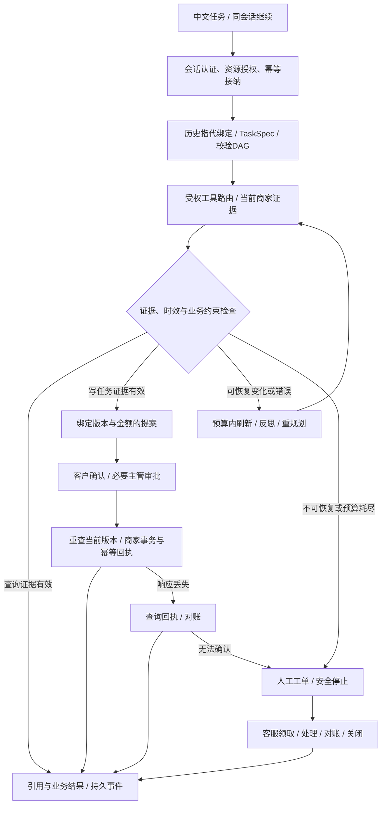

# 步骤10实际实现架构

2026-10-10。本文描述实际代码与可运行边界；总体设计中的扩展目标不自动视作已交付。质量比较见[预登记协议](../evaluation/step10-preregistration.md)，运维见[运行手册](../operations/runbook.md)。

## 用户与业务闭环

中文客户发起查询、退货、退款或取消订单任务。客户身份由服务端会话确定；模型不能指定租户、客户或审批角色。Agent先解析有依据的目标与订单，再编译带依赖的计划。逐工具读取当前订单、物流、政策与资格；涉及业务写入时先形成绑定金额、版本、范围和有效期的提案。客户确认与主管审批分别记录。执行前再次验证最新版本与审批；真正写入由商家事务和幂等键完成，结果以回执为准。无法继续时转工单，客服领取、处理、对账和关闭；客户可查询最终状态。

前端 React/Ant Design 提供任务计划、节点状态、业务结果与证据时间、确认卡片、审批队列、工单、知识库、记忆及技能管理。REST提交与读取；SSE承载标准AG-UI事件并支持持久游标恢复。没有额外实现WebSocket；双通道没有当前业务收益。展示结构化步骤及简短原因，不展示模型内部思维链。

任务计划、工具步骤、证据变更、等待确认、人工状态与最终结果均通过持久AG-UI事件提供给前端。最终结果不靠推理文字推断写入成功，必须与商家回执和事务状态一致。

## 四项深化实现

1. 可验证规划：Pydantic TaskSpec约束输入，业务投影按目录语义拆分复合需求；编译DAG的节点、依赖、读写顺序和绑定实体可验证。v6增加已发布投影的覆盖检查：原文已识别的属性如果在解析查询中遗漏，拒绝该计划并进入原有有限修复，避免只完成复合请求的一部分就报告成功；否定表达保留语义路径，未知属性不声称被此检查覆盖。LangGraph负责状态与PostgreSQL checkpoint，执行节点后的检查决定继续、刷新、重规划、澄清或人工接管。没有部署第二个认知Agent。
2. 工具路由：认证范围过滤先于检索；40个实际MCP工具使用发布方投影契约确定业务效果。明确效果走受控参数绑定；未知表述回落BM25/dense/RRF/qwen3精排及原生函数调用。工具schema、目录版本和参数再次验证，模型无权扩张权限。50/200/1000描述专项只评价路由组件；外部960个描述没有实际执行接口。
3. 时效记忆与上下文：拥有者隔离的会话实体账本、最近有限片段、历史引用卸载与Token预算构成上下文。情景记忆只记录建议，语义记忆来自有来源的RAG，程序记忆/AWM采用审批过的版本化工作流模板。旧金额、业务状态和历史审批不成为当前事实或授权。回指可绑定历史订单，但当前工具重新读取事实。明确回指已解析的实体不能被规划器静默遗漏；当前任务位于历史引用之后，避免旧请求替代当前目标。共同查询属性由各实体复用同一个原文片段，不通过补造实体句子放宽来源校验。会话删除停止召回，任务审计按独立保留政策继续存在。
4. 证据反思与恢复：观察包绑定来源、实体、版本、时间和schema；反思优先执行确定性证据/业务矛盾检查，再在预算内修复计划。变化状态触发刷新和提案失效；瞬时错误受限重试，成功写响应丢失先查询回执。持续不可用安全停止或转人工，不靠无界循环追求成功。

所有循环受活动时长、模型请求、Token和逻辑工具数限制；人工等待单独计时。Token按阶段返回的实际usage累计并在图节点边界检查，规划器内部的最多3次schema/传输尝试共享模型次数上界，但Token在该阶段返回后入账；因此一个阶段可能跨过Token停止阈值。停止后不再启动下一图节点的模型调用，不能将其描述成每次HTTP请求之前精确扣费或供应商端绝对Token硬限。非法工具参数的失败路径也保留已消耗的调用预算。

规划推理的schema修复与瞬时网关重试共享至多3次、且受任务剩余模型次数限制。408/429/5xx及传输异常可有限重试，400/401等配置或认证错误直接停止；失败请求也计入调用次数。该机制只重试推理，不重放商家写入。API未报告失败请求Token时标记usage缺失，不能将它解释为确定的零成本。

## 部署与数据可靠性

API、Worker、商家MCP和固定工具sandbox是独立进程；PostgreSQL是任务、事件、审批、幂等记录、业务模拟账本和outbox的权威存储。Worker以租约、fencing及checkpoint领取和恢复任务。Outbox通知使用Redis Pub/Sub，丢失通知时通过PostgreSQL轮询发现任务；未使用Redis Streams、Kafka或RocketMQ。PostgreSQL唯一约束、合法状态迁移和业务事务共同保障幂等，缓存键不能单独证明财务写入唯一。

Elasticsearch用于BM25，pgvector用于1024维向量，百炼Embedding/Reranker为真实远程API。RAG支持UTF-8 TXT/Markdown，传输层单文件与整请求分别100MiB；当前解析读取最多4,000,003字节、文本最多100万字符、最多1500段，因此本版实际文本文件入库约4MB以内。界面已提示这个限制，100MiB不是本版可处理文本大小。PDF、DOCX、OCR和大文档流式解析属于后续升级。

Nginx解析Docker动态DNS，连接失败可有限重试其他API实例；不启用non_idempotent，避免发送后的POST被透明重放。长SSE中断由客户端重连游标恢复。双API/Worker override只演练同宿主进程故障；数据库、Redis、MCP与入口仍为单实例。没有交付跨宿主/跨区HA、Kubernetes、Istio或生产故障域隔离。

## 安全、观测和模型

浏览器使用HttpOnly会话Cookie、CSRF校验；服务端共享会话使API扩容保持登录。Casbin RBAC与资源拥有者/租户ABAC共同授权。生产OIDC校验issuer、audience、nonce、state、签名及PKCE，并使用TLS与Secure Cookie；本地演示账户并不等于组织IdP已接入。日志、Trace与提示注入护栏避免将输入指令升级为可信权限。

Sandbox仅开放十进制定额计算、CSV摘要、文本统计等固定计算，通过无网络、只读根文件系统、资源限制和Unix socket隔离。当前提供独立认证计算API，主订单DAG没有自动调用这些计算工具。任意Python、shell或模型生成代码执行关闭；没有把普通Docker描述成任意不可信代码的充分隔离。

结构化日志、OpenTelemetry→Jaeger、Prometheus→Grafana与持久AG-UI轨迹关联workflow_id。Jaeger本地为内存存储，重启丢失Trace；PostgreSQL业务事件保留。未另部署LangSmith、Langfuse、SkyWalking、ELK，减少本机资源与重复运维。

LLM采用用户确认的OpenRouter deepseek/deepseek-v4.1-flash、temperature=0.3、reasoning.enabled=false及指定provider路由名单。实际供应商、usage与API报告cost存档；允许fallback会产生供应商差异，外部模型revision不可保证不变。没有多个模型账号，未实现未经验证的模型分类器降级链；请求重试、候选路由退化与人工接管是真实可用边界。

React、Antd、FastAPI、uv、SQLAlchemy异步、Alembic、fastapi-pagination、LangGraph、MCP与AG-UI使用锁文件冻结版本；镜像digest固定。Apache Shiro/Spring Security/SLF4J/Logback属于Java栈，本Python系统采用匹配生态组件。大组件由明确扩容与SLO需求触发升级，不以堆叠组件代表质量。
