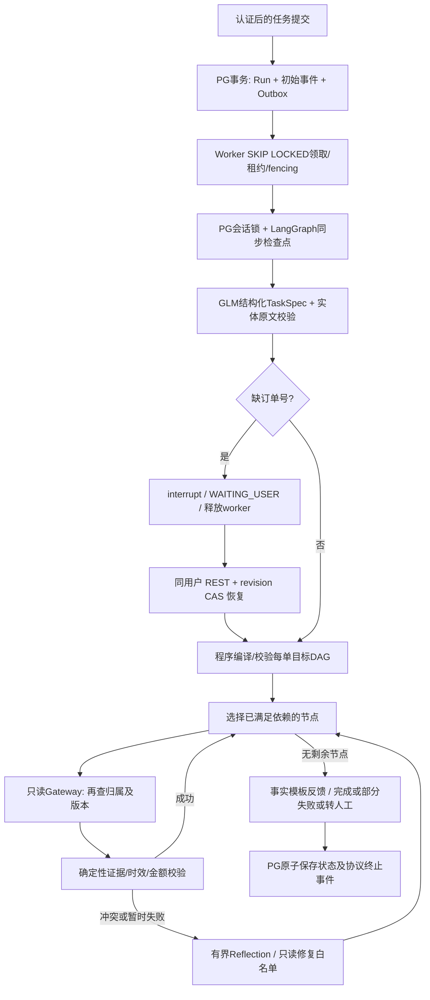

# 步骤 4：只读执行核心

本步实现单个认知 Agent 的最小纵向闭环。唯一外部生成模型是用户指定的 GLM-4-Flash；Planner 与 Reflection 是模块，不是协作 Agent。业务数据来自明确标识的电商模拟器，尚未连接商家系统。

## 执行流程

模型提交结构化意图，程序定义主流程和执行依赖；本步没有开放自由生成的可执行计划或任意工具名。TaskSpec 的 `order_goals` 将目标绑定到各订单，多订单缺少范围或目标并集不一致会进入最多两次结构修复。原文实体校验防止猜订单号；身份、审批和工具权限不能由模型提交。用户最多同时提出三个订单，本步计划最多十五个业务节点，通用计划上限二十个。

五个独立只读工具契约：`get_order`、`get_logistics`、`get_policy`、`check_eligibility`、`quote_refund`。每个契约重新查订单归属，未知与非本人订单返回相同错误。政策拒绝是有效业务结果，退款试算用整数分并核对实付金额，不生成“退款已完成”。固定模拟政策只处理整单退货，部分商品、运费、优惠分摊、实际写入和正式政策库留待后续步骤。

## 持久化与恢复

Run 同时充当本步持久任务记录；任务创建、首事件、Outbox 同一 PG 事务提交。API 不承担长任务。Worker 通过 `FOR UPDATE SKIP LOCKED` 领取，默认每进程最多两条任务；30 秒租约，每 10 秒续约，领取时增加 fencing。检查点连接上的 PG 会话 advisory lock 阻止同一工作流并发进入 LangGraph。事件及终态更新再次核对 fencing，旧执行者不能覆盖新执行者。外部业务写入口的 fencing、Operation Ledger/Inbox/CAS 在步骤 5 实现。

SDK 检查点表只由迁移初始化任务执行 `AsyncPostgresSaver.setup()`；worker 不重复建表。`durability="sync"` 写入每个执行边界。节点重放会复用已记录的 TaskSpec、只读工具结果或反思决策，并进行后续校验。检查点与事件不是跨表业务副作用事务：请求返回但尚未保存时仍可能重复模型/只读调用，用量也可能无法完整观察；不宣称外部 exactly-once 或准确的账单对账。

Outbox 至少一次发布 Redis Pub/Sub **唤醒提示**，API/worker 使用各自共享订阅连接；协议游标与任务领取始终从 PG 读取，通知丢失、重复或 Redis 中断不会丢任务。当前工作流调度有短间隔 PG 兜底扫描，SSE 亦有轮询兜底。此层无需把提示当作业务消息消费；步骤 5 处理业务事件/MCP 与消息 Inbox，Kafka/Redis Streams 的业务队列适用性重新随负载验证。

`WAITING_USER` 释放租约与执行资源，不持续占模型许可或事务。恢复输入只能提供订单号，不能提交 checkpoint thread_id、客户身份、任意状态或跳转目标。API 与 worker 重启后以服务端生成的同一工作流 ID + `Command(resume=...)` 继续。每次恢复生成新的 AG-UI invocation_id，generation 记录调用沿革。

## 安全边界、循环与观测

本地 alice/bob 演示账号采用独立随机密码、600000 次 PBKDF2、PG 服务端会话、HttpOnly/SameSite=Strict cookie 与 CSRF。账号归属只来自会话；登录 Redis 限流每客户端来源每分钟二十次，Redis 不可用时拒绝新登录。生产模式拒绝演示登录，完整角色、租户、权限策略及身份提供方是后续交付项。当前 HTTP localhost cookie 未设 Secure；正式 HTTPS 必须设置 SESSION_SECURE=true。

每客户最多五条未完成任务；默认每 worker 两并发，PG 连接池五、无 overflow、SQL 命令五秒超时，Redis 连接上限二十。只读单工具十秒超时，模型单请求默认三十秒；规划最多三次，反思最多两次结构尝试。图上限：工具三十次、模型十二次、已观察 token 两万、重规划三次、相同签名无新证据两次停止。活跃时间预算默认一百八十秒，PG 续约累计跨进程保留，等待用户不计入；崩溃后停机计时最多覆盖剩余租约窗口。recursion_limit=200 只是最后保险。

Reflection 只在验证失败后触发。错误类型及证据引用由程序确定，模型可建议 `refresh_order / retry_read / handoff`，建议要符合已验证错误的修复白名单。模型失效时只允许预先授权、仍受预算约束的只读恢复，否则停止；事件区分 validated_model_proposal、deterministic_safe_fallback 与 deterministic_stop，不能把程序兜底算作模型反思成功。

环境证据有来源、实体版本、观测时间、120 秒有效期和证据 ID。每个工具重新读取当前订单，并比较前置事实版本；模拟延迟后再取一次当前行。版本冲突使相关订单依赖重新读取，保留其他订单证据。该模式提供有版本的读取一致性，不承诺外部系统毫秒级同步；真实变更事件订阅、写入口 CAS 和政策更新在步骤 5 完成。

AG-UI 使用安装的 SDK 类型与编码器。PG 为每个工作流单调递增 seq，SSE `id`/`Last-Event-ID` 实现重连回放；状态、规划、工具、校验、反思通过标准事件或 CUSTOM 业务事件展示。每次执行 invocation 的终止事件在终态事务中去重；interrupt outcome 明确等待输入。SSE 单连接最长二十五秒，客户端须携带游标重连；每次循环验证会话是否有效。不会输出原始 CoT 或系统提示。

Worker 的 OTel run/tool spans 带 workflow_id、invocation_id、节点及 fencing；PG 持久业务状态计数、过期租约、待发 Outbox 以无客户/订单 ID 的指标暴露。数据库级 gauge 在多 API 副本上数值重复，Grafana 应取 max，不能直接求和。可观测性 Trace 当前仍为 Jaeger 内存存储，业务事件是独立 PG 持久记录。

## 官方契约依据

- [LangGraph interrupt 与节点重放](https://docs.langchain.com/oss/python/langgraph/interrupts)：持久化、typed response_schema 与 Command 恢复契约。
- [LangGraph Persistence](https://docs.langchain.com/oss/python/langgraph/persistence)、[Durability](https://reference.langchain.com/python/langgraph/types/Durability)、[AsyncPostgresSaver](https://reference.langchain.com/python/langgraph.checkpoint.postgres/aio)：同步持久化与 PostgreSQL 实现。具体签名以当前冻结安装包实查为准。
- [智谱工具调用](https://docs.bigmodel.cn/cn/guide/capabilities/function-calling)：本机额外实际验证指定 submit_task / submit_critique function 的 tool_choice，仍保留响应结构校验与有界修复。

本步验收是核心闭环及故障验证，行业领先、复杂任务成功率、超多工具路由精度、正式 HA/SLA 与基线增益均需后续冻结数据和 Docker 实测支持。
