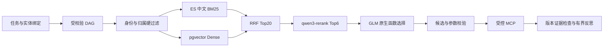
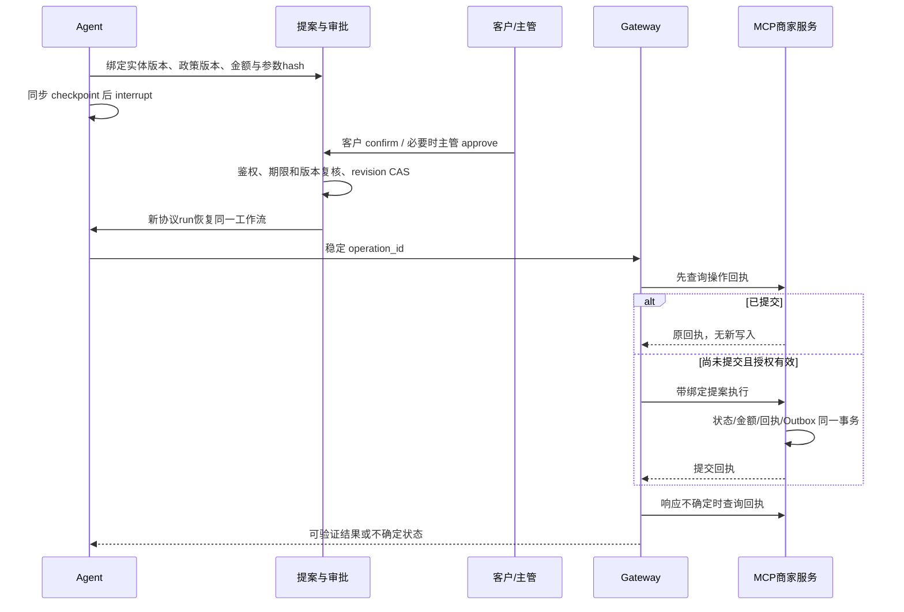

# 步骤 5：工具路由、MCP 与可核对的业务副作用

本文件描述已实现的阶段边界，最终验收见 [交付审查](../delivery/step5-business-gateway-review.md)。单个任务仍由一个 LangGraph Agent 执行；路由和反思是其内部模块。商家业务为可重置、独立进程运行的模拟系统，模型接口为真实云端接口。

## 业务边界

目录包含 37 个具有不同业务结果的只读工具和 3 个写工具，覆盖订单、支付、发票、物流、商品快照、售后、优惠、工单及回执。源目录为 `backend/app/business/catalog.py`，业务实现为 `service.py`。这些工具不是 40 个真实外部系统，也不是用同义名复制的 40 个接口。商品、价格、库存及物流资料来自明确标记的演示快照；订单、退货、退款、政策、工单和操作回执从当前数据库读取。模拟数据不等于接入真实商家。

本阶段的实际写入闭环：

| 操作 | 必需条件 | 确认与结果 |
| --- | --- | --- |
| 创建退货 | 本人本商家订单、已签收、在当前退货期限内、仍有退款余额、尚未申请 | 客户确认后生成 `REQUESTED` 退货申请；不直接退款 |
| 退款 | 上述归属及期限条件、退货已由仓库验收 `ACCEPTED` | 客户确认；超过商家额度还需主管批准；退还整单剩余实付并生成回执 |
| 取消 | 本人本商家、已支付且未发货、有剩余退款余额 | 客户确认及必要的额度审批；订单取消、剩余款退款、回执、事件同事务 |

默认政策为签收后 7 天内、资金操作**超过** 10000 分需主管审批；政策是有版本的商家记录，不由模型决定。10000 分等于 100 元。退货申请本身金额为零。部分 SKU/指定部分金额退款、改址、换货和补发当前转持久人工工单，不把请求扩大成整单退款。仓库验收属于外部商家事实，不能由客户的自然语言声明产生。

## 规划与权限优先的检索

`TaskSpec` 继续绑定每个订单的目标；新增 `queries` 保存逐字引用的具体查询片段。一个订单询问多个事项时编译多个节点，拒绝跨订单查询绑定、重复查询及超过预算的计划。业务效果、必需依赖和风险由程序确定；模型不能删除报价、政策、确认或审批节点。

模型接口要求完整输出五个任务字段，校验修复反馈使用白名单约束代码而不回传不可信输入。若所有提议实体均不在原文，或查询只有空实体占位且查询片段均可逐字验证，经有界修复后仍不能绑定，则清空实体/查询绑定、等待用户补充确认，绝不使用样例编号执行。类型、原文和额外字段检查仍保留；部分实体已匹配的混合错误不自动修补。缺订单号的通用查询在补号后重新解析，严格保持原目标集、原文查询片段与用户明确补充的实体集合；恢复解析结果及调用成本持久化以供重放。

只读语义查询先复核当前身份、角色、订单归属和商家归属，再进入检索。ES 查询带授权工具 ID 的过滤条件，向量查询也使用同一 allowlist；未授权描述不会送入选择模型。显式业务骨架节点使用精确效果匹配，避免为固定步骤增加无意义模型调用。通用查询只允许只读候选，写工具永远不能通过相似度检索取得执行授权。

BM25 与 dense 各召回最多 30 项，RRF 融合最多 20 项，再精排最多 6 项。模型只能调用这 6 个候选之一或 `clarify`；订单参数必须等于可信绑定实体。单检索器或精排失败时记录降级路径；两路召回均失败、候选不存在、参数不合法或选择不明确则停止该节点。精排分数尚未校准，不把分数当作写入授权。50/200/1000 合成扩展目录、Recall@K 和消融仍属于正式评测步骤。

ES 使用 `standard + lowercase + cjk_bigram`，无需安装未经验证的中文插件。工具向量为 `text-embedding-v4 / 1024`，精排为 `qwen3-rerank`。工具 schema、受控元数据和 embedding 模型配置均核对；漂移时拒绝执行。发布索引只为变更文档重新生成向量，避免每次部署重复付费。`stack.py up` 在基础服务就绪后发布索引；未发布的工具目录使新任务 admission 返回 503，数据库迁移本身不依赖云模型。

## MCP 与凭据边界

采用锁定的 MCP Python SDK 2.3.0：服务端 `MCPServer`、客户端 `Client + streamable_http_client + httpx2.AsyncClient`。使用 SDK 的 structured output、工具 schema 和 Streamable HTTP；处理 SDK 的预期业务错误及 task-group 异常包装，不手写 JSON-RPC。MCP annotations 只是提示，不能覆盖本地策略。[SDK 迁移说明](https://py.sdk.modelcontextprotocol.io/v2/migration/)、[客户端传输](https://py.sdk.modelcontextprotocol.io/v2/client/transports/)、[工具规范](https://modelcontextprotocol.io/specification/2026-07-28/server/tools)。

MCP URL 固定为部署配置；不接受用户、模型、文档提供的服务 URL。服务独立运行、无宿主端口、非 root、只读文件系统，不挂载 GLM/百炼密钥。独立 service key 验证内部调用，workflow/fence 由 Gateway 放入可信传输头，服务再查当前任务和账户。角色、客户 ID、商家 ID、审批布尔值不能作为模型工具参数。内部 Docker 网络使用 HTTP；外部真实商家接入仍须单独实现身份、网络及远端幂等契约。

输入 schema 完整 hash 与目录快照比对，服务端再次强类型校验。订单租户在创建时独立持久化；账户商家变更不会迁移旧订单。当前账户/主管失活或权限变更均在写事务内重新检查。订单金额、币种、已退金额和状态异常时拒绝业务处理。

## 副作用与人工审批

提案固定 operation ID、参数 hash、客户、商家、动作、订单版本、政策版本、金额、15 分钟有效期与主管要求。客户确认与主管审批分别持久化；客户不能自己批准额度，主管不能替代客户确认。approve/reject 使用 revision CAS。编辑现有提案不受支持；修改诉求需新提案和重新确认，不复用旧授权。版本或政策改变会使旧确认失效。

操作账本状态为 `PREPARED → DISPATCHED → RECONCILING → SUCCEEDED/REJECTED`。每次可能派发前先核对回执，恢复沿用原 operation ID。同 ID 不同参数拒绝；不同意图争抢同一余额由实体版本与业务状态阻止。业务服务锁定当前 run/fence、账户、政策、订单/商家绑定及提案，在同一事务中记录业务变更、回执和 Outbox。不能把 LangGraph checkpoint 当作外部写入的 exactly-once 保证。

已提交回执是不可变历史记录，不随读取缓存的 120 秒 TTL 失效；校验操作、金额、币种、动作和提交版本。确认过的写入失败不进入只读重试循环。提案创建前的版本冲突可刷新依赖；已完成写操作证据永不因读取重规划被删除。取消发生在提交后时返回部分完成及原回执，不能宣称已退款被撤销。

`get_operation_receipt` 默认只返回最近100条及 `has_more`；Gateway 在派发前和异常后传稳定 operation ID 精确查询，避免旧回执因分页截断而被误判丢失。返回列表不会成为无界上下文。Alembic 0006 增加订单/客户/时间索引，原先已执行的迁移不重写。

## 环境事件与人工接管闭环

商家 Outbox 与写入同事务，消费侧 Inbox 以事件 ID 唯一去重，环境版本以 `greatest` 阻止倒退。此 MVP 使用 PG 持久投递/消费，Redis 是唤醒提示；没有为了组件数量增加 Kafka。当前工具仍读取权威数据库并复核版本，事件不是资金授权。读取链携带政策依赖版本；跨政策版本的资格/试算会失效并刷新。

`HANDOFF/PARTIAL` 与人工工单、接管包和 AG-UI 事件同一事务持久化。客户只能读取自己的工单；同商家 support/supervisor 可领取，只有当前领取者可以核对或关闭；操作使用 revision CAS，并写入审计。未知业务操作未对账时禁止关闭。接管包包含原因、请求实体和操作引用，避免把原始用户消息、系统提示词或模型思维链复制进去。

工单的人工核对仅利用本模拟商家的**共享事务及 fencing 契约**：取得终态 run 锁意味着此前持有该锁的商家事务已经提交或回滚，终态又禁止新派发；没有成功回执的 pending 操作可以据此确认为未提交。真实远端商家不能使用此推理，必须查询远端权威回执；不允许根据本地 timeout 或 checkpoint 判定未退款。

## 可观测性与阶段限制

AG-UI 包含计划、逻辑步骤/工具事件、实际 MCP 工具路由、提案、确认等待、回执及接管工单。通用 `business_query` 是逻辑节点名，实际工具名在 `business.tool_route.selected_tool` 中。API/worker/Gateway/MCP 的 OTel trace 通过传输头关联；PG 是业务审计依据。Prometheus 使用有限状态标签，不使用用户、订单、operation ID 标签。

本阶段提供后端协议和 CLI 审查入口；完整 React 客户/客服工作台在步骤 8。生产身份提供方、完整护栏与 sandbox 在步骤 7；记忆/知识库/上下文工程在步骤 6；冻结黄金集与真实 Docker 成对基线评测在步骤 9。单机 Compose 中数据库、Redis、ES 等仍为单实例，不宣称已达到多机 HA 或超过 Agentforce/Dify 的质量。
