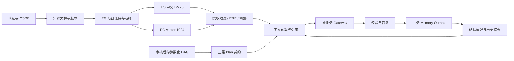

# 步骤 6：记忆、RAG、AWM 与上下文工程

2026-10-09。入口为 [交付审查](../delivery/step6-context-memory-review.md)。沿用 [核心设计 v2](agent-core-v2.md) 和 [业务网关](step5-tools-and-effects.md)。

## 运行与信任边界

Harness 新增 `load_context` 与 `prepare_context`。意图解析只使用当前用户原文；历史不能补造订单或目标。知识查询使用 `knowledge` goal 和空 `order_id` 的逐字查询片段。GLM 原生函数选择直接回答问题的引用，每条必须来自当前授权 chunk 并与原文逐字一致；生成后再次核验权限与版本，无支持引用转人工。生成故障时明确标记并返回检索原文，最多2次生成调用，计入模型和上下文预算。具体订单资格、金额和写入仍调用当前商家工具。ContextBuilder 实际参与模型工具选择，函数候选、参数、审批和业务效果继续由网关控制。

| 层 | 存储 | 准入与用途 |
| --- | --- | --- |
| 工作状态 | Checkpoint、事件、业务账本 | 原用户目标、TaskSpec、DAG、完成/失败、审批及操作引用；保留原始证据 |
| 确认偏好 | customer_memories | 用户显式 PUT 枚举键值，不接受自由指令、身份或授权 |
| Episodic | memory_outbox → PG + pgvector | 目标类别、状态、已用工具、未决标记与源 run；不存订单号、金额、地址、原始消息或工具正文 |
| Semantic / RAG | knowledge_documents/chunks、ES | tenant/customer/scope/role、生效期、版本、hash、来源、审核；policy 必须主管审核 |
| Procedural / AWM | workflow_memories | 成功开发轨迹的参数化 DAG，候选→结构回放→主管批准；版本漂移禁用 |

Namespace 来自共享会话/当前账号。客户不能发布 tenant 文档，不能审查政策和工作流；客服不能读取客户私有记忆。知识资料受 visible_roles 约束，私有资料仅发布人可检索。UUID 不授予访问权。审核文档也是参考，不能修改 merchant_policies 或审批。

记忆默认保留 90 天，偏好可选 1–365 天。删除清空内容与向量、保留无正文审计和墓碑；删除全部还关闭自动记忆，重新开启必须显式设置。历史业务账本和用户自己的原始 run/事件仍保留，不作为客户记忆检索正文。

## 文档与检索

首版接受 UTF-8 TXT/Markdown、文本 JSON 接口，不接受 PDF/DOCX/OCR 或可执行格式。100 MiB 文件/请求限制仍在；额外保护为解析后最多 1,000,000 字符、1500 段，上传流最多 4,000,003 字节。700 字符分段、100 字符重叠，不生成摘要、不执行附件。

文档 QUEUED→INDEXING→READY。网络错误间隔 15 秒、最多 3 次，再 FAILED；发布者可显式 retry。每账号最多 5 个待入库文档。120 秒 lease token、版本和状态共同防止旧 worker 发布。每批最多 10 段 embedding，段 UUID 按文档/版本/段号确定，恢复复用已完成段。

仅 READY 可查。更新立即清除旧 PG 段、提升版本、撤销审核；删除立即清空 PG 正文和段，旧 chunk 引用立即 404。ES 清理异步重试，并覆盖可能迟到的旧发布窗口；PG 权威过滤阻止旧索引恢复访问。历史已发送回答仍保存在用户自己的 run 中，不再次作为知识检索正文。

检索先在 PG 筛选授权、生效、未过期、model 匹配的段；policy 还要求 APPROVED。ES CJK bigram BM25 与 PG cosine dense 各 Top-30，均只接受授权段 ID。RRF 使用 1/(60+rank)，最多 20 个候选。精排前回 PG 重核验，再调用 qwen3-rerank；返回前再次核验。引用含文档/段 ID、版本、hash、来源、时间及信任标记，回取端点执行同样权限检查。

一个检索器失败时标记降级，两个失败返回 503；精排失败标记并退回融合序。首版不把 raw score 当概率，不宣称校准阈值。单 namespace 最多 10000 个可授权段，超限返回容量错误。正式召回率、答案质量和消融需要冻结语料及标注集。

## AWM、Skills 与评测隔离

来源必须是本人 development 分区、最终 SUCCEEDED、每个计划节点均有验证通过事件的 run。保留源 run 私有引用与原计划的工具/schema/政策版本，不兼容当前版本时拒绝候选。模板只保留 goals、BOUND_ORDER 占位 DAG、必需槽位和失败边界。

支持固定订单、物流、资格、试算、整单退款、退货、取消骨架，不学习任意 business_query 文本或未知动作。结构回放以 1/2/3 个绑定订单对比正常编译结果；这是结构回归，不是三次真实业务执行或质量证明。主管 validate 后才能 approve。复用再次核验 hash、工具/schema/政策版本、有效期、当前输入，并通过正常 Plan 校验；历史订单、金额和审批不能继承。

按元数据匹配后才实例化 DAG，可导出有标准 frontmatter 的 SKILL.md，固定 publisher/version/hash 和类型化 JSON 模板；不执行任意上传 Skill、路径、shell 或提示词。版本漂移立即 DISABLED 并正常规划 fallback；Skill 导出也检查版本。

POST /runs 可设置 dataset_partition="evaluation"：不读取历史记忆、不复用 AWM、不排记忆 Outbox，也不能用该轨迹训练。RAG 仍可读授权知识语料，评测前需外部冻结语料版本。

## 上下文预算与限制

默认配置窗口 32768、输出预留 2048、工具预留 4096、安全预留 1024，可用输入 25600；70% 卸载线，90%（23040）硬线。窗口是配置值，未实测所有供应商版本的最大窗口。无供应商 tokenizer，本地用 UTF-8 序列化字节数作为保守 token 上界，实际 usage 单独记录。

优先保留固定约束/可信身份、原用户目标、TaskSpec、DAG、当前节点、完成/失败、审批与操作引用；再放当前事实、确认偏好、历史摘要和检索内容。大工具结果卸载为 evidence pointer，原值仍在 checkpoint/事件；知识引用可鉴权回取。关键状态不改写、不截断 JSON，必需状态超限转人工。模型请求还检查完整 body 上界，schema 只发送一次。

每个执行边界重新读记忆/知识 refs，删除后不从 checkpoint 再装载正文。事件记录引用数量、来源和预算，避免复制私有正文。当前是单任务原文、类型化补号和审批；尚未实现生成式长对话摘要、任意新用户纠正消息接口或历史 tool 消息配对压缩，不从本步预算检查外推这些能力。
