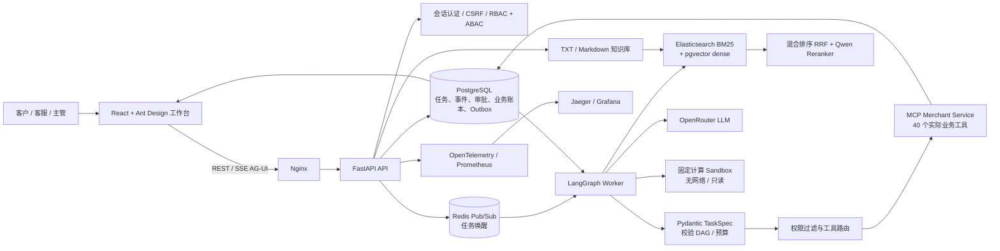

# 电商智能客服 Agent：架构设计、技术实现与使用说明

> 面向 Agent 开发工程师求职与项目演示。本文以当前仓库实现和 2026-10-11 已完成的评测记录为准；不把设计目标、行业宣传或未交付能力写成交付事实。

## 1. 项目定位与简历介绍

### 项目目标与行业问题

国内智能客服市场已经有成熟厂商，不能把项目包装成“国内没有同类产品”。市场数据可以说明需求增长，但不能单独证明 Agent 能力的市场渗透率：IDC 数据报道显示，2025 年中国企业级智能客服市场规模为 71.9 亿元、同比增长 55.3%[（2026 年报道）](https://finance.ifeng.com/c/8w6BT6TpGFZ)。中国信通院《智能体技术和应用研究报告（2025 年）》将认知规划能力、场景创新和安全治理列为仍需解决的挑战[（报告发布与内容摘要）](https://www.cww.net.cn/article?id=601665)。

因此，本项目的差异化定位是：把“客服能回答”推进到“**客服 Agent 能在受控范围内办完复杂售后事务**”，并为任务计划、事实证据、审批、写入回执和故障恢复提供可追踪记录。它是一套可本地部署、针对模拟商家系统验证的工程样例，不声称代表国内市场空白或生产商家效果。网络上流传的“完整 Agent 自主决策产品占比不足 15%”未找到可核验的信通院原始出处，建议不要将该比例写入简历。

面试中提到“产品空白”时，建议把范围落在工程能力断层：对于订单/退款等高风险任务，如何把身份权限、当前证据、客户授权、主管审批、事务幂等、回执核对和人工接管组成可验证的业务闭环。本项目实现并测量了这组能力组合；没有进行全量竞品评测，因此不宣称国内现有产品都不具备这些能力。

### 一句话项目介绍

> **项目目标：** 面向电商售后中“多订单与多来源事实核验、退款等高风险操作需要客户授权、主管审批和可追溯执行”的工程问题，构建中文单 Agent 客服系统；覆盖订单/物流查询、退货退款与取消任务、知识库问答、客户确认、主管审批、幂等事务回执和人工接管。

### 可直接改写进简历的项目条目

> **电商智能客服 Agent（全栈项目）**：面向订单查询、退货退款、取消订单等售后场景，设计并实现基于 LangGraph 的持久化 Agent 执行系统；使用 Pydantic TaskSpec 与校验 DAG 约束计划，结合 MCP 商家工具、当前业务证据校验、客户确认/主管审批、PostgreSQL 事务与幂等回执，完成从任务受理到人工接管的闭环。基于 Docker Compose 部署 React 工作台、FastAPI、Worker、PostgreSQL、Redis、Elasticsearch/pgvector 与隔离计算 Sandbox；在冻结模拟评测中，V4 时效记忆主集严格成功率为 180/180，对照向量历史基线为 62/180；可恢复故障集为 144/144，对照反思关闭基线为 48/144；另完成 2 小时 Docker 连续运行验收（120/120 只读任务通过、0 失败）。

请根据自己的实际工作范围，把“设计并实现”改成准确的个人贡献描述；如果不是独立完成，不要写“独立负责/独立开发”。

### 真实业务场景

客户在同一会话中询问“ORD-1002 预计何时送达”，接着询问“申请退掉这件商品并退款”。系统需要先识别订单和商品，读取当前订单、物流、售后政策、资格与金额证据；再生成带金额、状态版本和过期时间的提案；等待客户确认及必要的主管审批；执行前重新核对状态，通过商家事务提交并以 receipt（回执）核实结果。状态已变化、证据过期或结果无法确认时，系统刷新、重新确认或转人工，不用模型生成的文字代替真实业务结果。

## 2. 架构总览

系统采用浏览器工作台、API、持久化 Agent Worker、商家 MCP、数据库和检索/观测基础设施分层部署。PostgreSQL 保存任务状态、事件、checkpoint、确认/审批、幂等记录、模拟业务账本和 Outbox；Redis 用于通知，不承担业务事实存储。



### 核心执行闭环

1. **接收任务**：服务端会话确定客户、租户和角色；API 做资源授权与幂等接纳。
2. **解析并计划**：把用户目标解析为 Pydantic TaskSpec，绑定订单/商品等实体，编译具依赖关系的可验证 DAG。
3. **取当前事实**：经权限过滤的 MCP 工具读取订单、物流、商品、政策及售后资格；事实包含来源、时间、实体和版本。
4. **核验并决策**：检查目标覆盖、证据时效、业务约束与工具返回；按预算继续、刷新、有限重规划、澄清或转人工。
5. **受控写入**：写操作先生成绑定当前状态版本、金额和作用域的提案；客户确认与必要的主管审批独立记录。执行前重新读取事实，状态变化会让旧提案失效。
6. **回执对账**：事务携带幂等键；响应丢失时先按 operation receipt 查询和对账，不能把超时理解成“肯定没写入”后直接再扣一次款。
7. **持久展示与恢复**：业务事件进入 PostgreSQL，AG-UI SSE 以游标续传；Worker 依靠租约、fencing 与 LangGraph checkpoint 接管未完成任务。

## 3. 模块与技术实现

| 模块 | 主要实现 | 选择理由与职责 |
|---|---|---|
| Web 工作台 | React、TypeScript、Ant Design、Vite、Nginx | 提供客户/客服/主管工作台；以 REST 提交和查询，以 AG-UI SSE 展示任务步骤、证据、确认卡片、审批、工单和最终回执。 |
| API 与身份 | Python 3.12、FastAPI、Pydantic Settings、Casbin、OIDC、HttpOnly Cookie、CSRF | async API 和 OpenAPI 便于分层接口与验证；RBAC 管角色，资源拥有者/租户 ABAC 管数据范围。演示使用本地账户，OIDC 协议验证不等于已接入真实组织 IdP。 |
| Agent 执行 | LangGraph、PostgreSQL checkpoint、Pydantic TaskSpec、校验 DAG | LangGraph 管持久状态、暂停和恢复；DAG 将目标、实体、步骤依赖与读写顺序显式化，便于校验和业务审计。系统只有一个业务 Agent，没有部署多个认知 Agent。 |
| 工具层 | MCP、40 个商家模拟工具、发布方工具投影契约 | MCP 将 Agent 与商家业务接口解耦；真实工具按身份和权限过滤、再次校验参数与版本。评测目录中额外的 960 个公开描述仅为路由干扰项，没有执行接口。 |
| 事务与队列 | PostgreSQL、SQLAlchemy async、Alembic、Outbox、Redis Pub/Sub | PostgreSQL 是任务与业务事实权威源；Redis 只加速唤醒，Worker 还能轮询数据库 Outbox，因此单条 Redis 通知丢失不会成为唯一任务来源。 |
| 知识检索 | Elasticsearch BM25、pgvector 1024 维向量、RRF、DashScope Embedding 与 Qwen Reranker | 词法与语义召回互补，再融合排序和精排；知识片段带来源与版本，答案可引用。当前仅支持 UTF-8 TXT/Markdown；尽管 HTTP 上传上限为 100 MiB，现有解析路径实际约可处理 4 MB 文本、最多 100 万字符/1500 段。 |
| 模型调用 | OpenRouter 的 **deepseek/deepseek-v4.1-flash**；temperature 0.3、reasoning=false | 通过兼容接口降低应用与供应商耦合；记录真实 serving provider、usage 与错误。外部模型版本及 fallback 供应商差异意味着结果并非逐字确定。 |
| 隔离计算 | 独立 Sandbox 容器、无网络、只读根文件系统、限额、Unix socket | 仅开放固定的十进制计算、CSV 摘要和文本统计等工具；任意模型生成的 Python/Shell 代码执行关闭。 |
| 部署与观测 | Docker Compose、镜像 digest、OpenTelemetry、Prometheus、Grafana、Jaeger | API、Worker、MCP、Sandbox、数据库与前端分容器；指标、Trace 与持久事件关联。Docker Compose 是本地/单宿主交付，不是跨故障域 HA。 |

**关键代码入口**：**backend/app/agent/** 为 Agent 契约、规划、运行和存储；**backend/app/business/** 为商家业务与 MCP；**backend/app/context/** 为会话上下文和记忆；**backend/app/api/** 为 HTTP API；**frontend/src/** 为工作台；**infra/docker-compose.yml** 为容器栈；**sandbox/** 为固定计算隔离服务。

### 安全与记忆设计

- 客户身份取自服务端会话，模型不能指定客户、租户或审批人。
- 会话记忆用于绑定历史订单等指代，不授予权限，也不作为当前订单金额、物流状态或旧审批的事实来源；执行前重新读取商家系统。
- 对话中检索到的文本仅作为数据处理，不能提升成可信指令或绕过授权。
- 超时重试只作用于允许重试的推理请求；商家写入依赖幂等键、事务和回执对账。
- 循环有模型请求、Token、工具数与活动时长预算；不可恢复错误会安全停止或转人工。
- Trace 本地 Jaeger 为内存存储，重启后可能丢失；关键业务事件保存在 PostgreSQL。

## 4. 本地部署与使用

### 前置条件与配置

需要 Docker Desktop（含 Compose）、Python 3.12、**uv 0.11.19**，以及可用的 OpenRouter 和阿里云百炼 API Key。项目锁文件与容器镜像 digest 已冻结。不要把真实 API Key 或演示密码提交到 Git。

在项目根目录打开 PowerShell，先准备本地配置：

```powershell
uv run --project backend --frozen python scripts/bootstrap.py
```

Bootstrap 会生成本机随机 Secret，并保留已有值。按提示或直接将 API Key 写入本地 **.secrets/openrouter_api_key** 与 **.secrets/dashscope_api_key**；密钥由容器 Secret 挂载读取，不写进源码或前端。OpenRouter 的密钥不要误填到兼容变量名对应的智谱 Secret 文件。

### 启动与入口

```powershell
uv run --project backend --frozen python scripts/stack.py up --profile search --profile observability
uv run --project backend --frozen python scripts/stack.py smoke
```

启动后：

| 用途 | 地址 |
|---|---|
| 客户 / 客服 / 主管工作台 | http://localhost:8080 |
| FastAPI OpenAPI 文档 | http://localhost:8000/docs |
| Prometheus | http://localhost:9090 |
| Grafana | http://localhost:3001/d/agent-infra |
| Jaeger Trace | http://localhost:16686 |

演示用户为 **alice**、**bob**、**support**、**supervisor**；每个密码只在本机 **.secrets/demo_*_password** 中查看。Grafana 管理员密码在 **.secrets/grafana_admin_password**。所有宿主端口绑定 **127.0.0.1**。

### 推荐演示流程

1. 使用 **alice** 登录，在工作台提交带订单号的只读问题，例如“查询 ORD-1002 的承运商和预计送达时间”，观察计划、MCP 工具步骤、证据时间与引用答案。
2. 在同一会话继续询问另一笔订单，演示历史实体绑定；Agent 仍须重新调用当前订单/物流工具，不直接复用历史状态。
3. 提交退货、取消或退款请求，观察系统先查政策和当前资格，再生成待确认提案；客户确认后，主管按界面流程审批（仅在规则要求时），最后执行并展示真实回执。
4. 在提案等待期间更改模拟订单状态，可观察旧提案失效、重新取证和重新确认；不会继续使用过期审批。
5. 客服用 **support** 账号查看并领取转人工工单，处理、对账、关闭后，客户可回到会话查看最终结果。
6. 知识库管理只接受 UTF-8 TXT/Markdown；上传后执行解析/索引，再提问验证引用。当前不支持 PDF、DOCX、OCR 或超出解析边界的大文件。

### 停止

停服务但保留数据库卷和本地数据：

```powershell
uv run --project backend --frozen python scripts/stack.py down --profile search --profile observability
```

不要运行 **down -v** 或全局 Docker prune 来清理本项目数据。健康状态先看 **/api/v1/health/live** 与 **/api/v1/health/ready**；退款等写入请求超时后先查 operation receipt，不要手工重复提交。

## 5. 项目成果与量化对比

以下是仓库中已完成并留有原始轨迹的 Docker/真实模型模拟评测；它们不是线上生产 A/B，也不是对所有客户的效果承诺。“严格成功”检查终态、订单作用域、当前证据、工具效果和回执等隐藏约束，而非只看任务显示为 SUCCEEDED。重复 trial 用来观察同场景波动，不算新增独立场景。

| 成果 | 基线与口径 | 项目结果 | 解读 |
|---|---|---|---|
| 可验证规划 | B2：原生 ReAct + BM25/dense/RRF/reranker；36 个新复杂场景 × 5 trial，共 180 单元，29 families。严格成功 117/180（65.00%）。 | P：159/180（88.33%），多 42 个严格成功单元；family 均衡差 +9.14pp，95% 聚类区间 [−4.66,+23.45]pp。 | 原始样本率高 23.33pp，但区间含 0，尚不能证明总体稳定正效应；未达到预登记的 P ≥90% 门槛。简历可展示方法与结果，需同时披露这个限制。 |
| 时效记忆与上下文 | M-vector：最近 5 条对话 + 查询向量检索历史 Top8；60 个新组合 × 3 trial，共 180 单元、13 families。严格成功 62/180（**任务级** 34.44%；**family 均衡率** 24.36%）。 | P：180/180（100%）；family 均衡差 +75.64pp（= 100% − 24.36%），95% 区间 [+55.13,+92.31]pp。 | 在这组冻结模拟任务上达到预登记的绝对成功率与差值目标；没有独立人工盲审。**注意两个成功率口径不可互推**：任务级 34.44% 与均衡率 24.36% 相差 10.08pp，源自 36 单元的对照 family 在两套口径中权重不同（20% vs 1/13），故 100% − 34.44% = 65.56pp 并不是 family 均衡差。另在两组都正确且 usage 完整的 62 个配对上，Prompt Token 513,308 → 180,291，下降 64.88%；该条件仅覆盖主集 34.44%（与任务级成功率同源同值），不含离线 Embedding 成本。 |
| 失败恢复 | A-reflect：关闭证据反思，保留底层共享重试及 receipt 去重；48 类可恢复故障 × 3，共 144 单元、6 families。严格成功 48/144（33.33%）。 | P：144/144（100%）；family 均衡差 +66.67pp，95% 区间 [+33.33,+100]pp。永久故障停止与无故障对照分别单独计分，不混入此分母。 | 支持“证据刷新、有限修复和回执对账帮助可恢复故障完成”的结论；样本仅覆盖登记的故障族，family 数较少。 |
| 工具路由规模 | 1000 项候选目录：40 个真实商家工具 + 960 个固定公开工具描述作为干扰；两组均 50 例 × 3 trial，共 150 单元。R-hybrid 严格成功 150/150。 | P 严格成功同为 150/150，差值 0pp。 | 结果说明该规模组件测评无回退，不支持“路由准确率胜过混合检索”或“1000 个真实 API 均可调用”；基线已达样本上限。 |
| Docker 两小时连续运行 | 预定目标：7200 秒、120 个只读到达、0 失败且开始/结束部署清单一致。 | 实测 7200.015 秒；120/120 通过、0 失败；123 次模型调用，298,160 个报告 Token；资源采样 223 点，项目普通服务容器峰值 2.235 GiB，结束时重启数 0、OOM=false。 | 达到本轮连续运行验收目标。峰值不含 benchmark 容器、Windows/WSL 和其他项目；PostgreSQL 与 benchmark 共享宿主，该结果不是跨故障域可用性承诺。 |
| Docker API 控制负载 | 直接控制 API，10 并发 × 600 秒为参考：174.37 RPS、P95 约 79 ms。 | 50 并发 × 600 秒：158.75 RPS、P95 约 563 ms，所有请求 HTTP 200；相对 10 并发吞吐下降约 9%，P95 约为 7.1 倍。 | 只测不触发 LLM 的控制 API，不代表 Agent 对话吞吐；100 并发触发预登记延迟停止条件，未完成 600 秒，不记为通过。 |

额外工程验收记录：V6 镜像业务验收覆盖 9 项检查、8 次真实模型任务；后端 293 项测试在 Windows 与 Docker Linux 均通过，前端 SSE 5 项测试及 TypeScript 构建通过；同宿主双进程演练中 Worker 停止后约 30.19 秒被接管，fencing 从 1 增至 2，28 条事件连续。这些是已留档的工程结果，不等于真实商家上线或生产 SLA。

### 如何复核

- [最终量化复核](evaluation/step10-final-v6-quantitative-review.md)：四项主指标、置信区间、Token/费用口径、失败样本和边界。
- [最终交付审查](delivery/step10-final-review.md)：Docker 业务验收、基础设施、压力和浏览器验收。
- [运行手册](operations/runbook.md)：启动、健康检查、备份恢复、连续运行及故障演练。
- [实际实现架构](architecture/step10-delivered-system.md)：代码边界、部署数据流、重试和安全细节。

测评轨迹、冻结镜像与原始 provider 调用保存在 Git 忽略的 **artifacts/**；费用字段是网关报告，不是财务账单。需要重跑模型 benchmark 时会产生真实 API 费用，应使用报告给出的冻结 schedule、隔离 Compose 配置和专用新输出目录，不覆盖既有证据。

## 6. 亮点、难点与踩坑复盘

### 可用于面试的技术亮点

| 难点 | 解决思路 | 实际效果或取舍 |
|---|---|---|
| 复合售后请求容易漏掉一个商品属性或订单实体 | 用 TaskSpec 和 DAG 显式记录目标覆盖、实体绑定、依赖顺序与读写类型；对已发布的业务投影做覆盖检查，遗漏目标就拒绝“成功”并进入有限修复。 | 规划主集 P 159/180、B2 117/180；但 family 区间包含 0，仍保留未达绝对目标的事实。 |
| 历史摘要会把旧订单状态当成当前事实 | 拥有者隔离的实体账本用于指代解析，时间/作用域/引用卸载纳入预算；历史状态与审批不继承，每次关键读取再查商家工具。 | V4 新题 P 180/180，向量历史基线 62/180；仅适用于登记场景且未盲审。 |
| 外部 API 超时与退款事务提交可能产生重复写入风险 | 以 PostgreSQL 唯一约束、合法状态迁移、事务和 operation receipt 建立幂等边界；发送后响应丢失时查询回执并对账，不重放非幂等 POST。 | 故障恢复主集 144/144 对 48/144；另有写后丢响应的业务故障注入验收。 |
| Worker/SSE 长流程要在断连、进程重启后继续 | 持久事件与 checkpoint、租约和 fencing 管理执行权，AG-UI 游标支持断线续传。 | 两小时 120/120 只读任务通过；同宿主 Worker 接管约 30.19 秒，不能外推为跨宿主 HA。 |

### 踩坑故事：定位 → 原因 → 解决 → 结果

1. **Docker 升级后新业务迁移未生效**
   - **现象：** v5 故障验收中，服务启动后发现旧 migrate 容器不认识 0010 schema revision。
   - **定位：** 仅更新 API/Worker/Web，遗留了版本旧的 migrate 容器；API 与迁移器版本不一致。
   - **解决：** 升级流程改为先重建并成功运行迁移器，再发布长期服务；stack.py up 统一同步迁移器镜像。
   - **结果：** v6 按新顺序再次完成 9 项业务检查、8 次模型任务；原失败日志保留用于复盘。

2. **100 MiB 上传配置不等于 100 MiB 文本入库能力**
   - **现象：** HTTP 层可以接受较大的请求，但解析器在文本读取与分段阶段有更严格上限。
   - **定位：** 把传输层 UPLOAD_MAX_FILE_BYTES 与实际 parser 的字节数、字符数和 chunk 数限制混为一谈。
   - **解决：** 按真实实现标明约 4 MB 文本、100 万字符和 1500 段上限；界面提示解析边界，不宣传 PDF/OCR 或大文件能力。
   - **结果：** 上传 API 容量与知识入库能力分开说明，评测与演示不会把“请求接收成功”误说成“文档已完整索引”。

3. **退款请求超时，不能判断事务是否已经提交**
   - **现象：** 商家端可能已完成退款，但响应包丢失，Agent 只观察到超时。
   - **定位：** HTTP 失败状态并不能证明数据库事务回滚；盲目重试会产生重复扣款/退款风险。
   - **解决：** 写路径使用业务幂等键和事务记录；超时后按 operation receipt 查询、核对账本后再返回结果，无法确认则转人工。
   - **结果：** 冻结恢复集覆盖写入后丢失响应的场景；P 144/144 对 A-reflect 48/144，并将永久故障安全停止另行统计。

4. **Linux Docker 测试首次失败，后来确认是测试环境缺挂载**
   - **现象：** 一次命令未收集到脚本测试，第二次运行的 11 项测试因 Sandbox 挂载缺失失败。
   - **定位：** 容器测试命令没有完整设置脚本路径与隔离测试所需挂载，属于测试执行环境问题。
   - **解决：** 补齐脚本目录和 Sandbox 测试挂载后，重新运行完整测试，不删除失败记录，也不通过削减测试绕过问题。
   - **结果：** 后端 293 项在 Docker Linux 全部通过（6.24 秒）；Windows 运行也通过（21.23 秒）。

## 7. 交付边界

- 商家订单、仓库和财务由可审计模拟系统支撑；不是已接入真实电商平台。
- 本地账户和测试 OIDC issuer 不是组织生产身份系统；组织 IdP、生产 TLS、异地加密备份未验收。
- PostgreSQL、Redis、MCP 等仍为单宿主单实例；同宿主进程接管不等于数据库 HA 或跨区域容灾。
- 知识库目前支持 TXT/Markdown，PDF/DOCX/OCR 和大文档流式解析未实现。
- 1000 项路由目录评测只有 40 个可执行商家工具，其余均是搜索干扰描述。
- 新场景没有独立人工盲审；供应商报告费用与实际账单可能不一致。记忆 Token 条件比较不包含离线 embedding 成本。

这些边界不妨碍将项目讲成扎实的 Agent 工程作品；面试时应把“本地可复现模拟闭环”与“生产商家效果”清楚区分。

