# Agent 开发岗面试辅导：十道高概率题的知识点精讲与高分作答

> 适用对象：基础较薄弱的同学 ｜ 目标岗位：行业智能算法研究-智能体（电气/机械领域）
> 你的项目：电商 L4 级智能客服 Agent（LangGraph + MCP 40 工具 + 混合检索 + 幂等事务 + 预登记评测）
> 资料来源：IMA 知识库「【Agent+大模型+python+React】」（164 项，含 Anthropic《Building Effective Agents》、LangGraph/MCP 架构指南、RAG 实战、多模态大模型、2026 大厂 Agent 面试真题集）+ 2026-10 联网检索
> 生成日期：2026-10-16

---

## 0. 怎么用这份材料

### 0.1 每题的结构

每题都分两部分，**请按顺序学**：

| 部分 | 内容 | 用途 |
|---|---|---|
| **第一部分：知识点精讲** | 定义 → 比喻 → 对比表格 → 流程图 → 主流工程实现 | 让你真正懂，应对追问 |
| **第二部分：面试示例回答** | 一段可直接背诵的结构化回答 + 关键词加粗 | 让你说得出来，说得漂亮 |

> ⚠️ 学习顺序建议：**先只读第一部分**，合上文档用自己的话讲一遍；讲不顺就回头读。**最后再背第二部分**。只背第二部分最容易在追问时崩盘——面试官一追问"为什么"，背的答案接不上就暴露了。

### 0.2 一个关键认知：你的项目与这份 JD 的关系

你的项目是**电商客服**，JD 是**电气/机械**。面试官一定会问："这两者有什么关系？"

**正确心态不是"硬套"，而是"同一套工程骨架，换一个领域"**：

| 能力骨架 | 你的项目（电商） | 迁移到 JD 域（电气/机械） |
|---|---|---|
| 工具/能力封装 | 40 个商家 MCP 工具 | 图纸解析工具、时序模型工具、工单工具 |
| 检索增强 | BM25 + pgvector + RRF + 精排（纯文本） | 图纸多模态 RAG + 图谱（拓扑） |
| 确定性计算 | 固定计算沙箱（定额计算、CSV 摘要） | 时序分析小模型、机理计算 |
| 受控写入 | 退款/退货/取消 + 幂等回执 | 工单派发、参数下达、告警确认 |
| 评测 | 预登记 + family 均衡 + 聚类 bootstrap | 同一套方法论可复用 |

**这五条骨架就是你可以大方承认"领域不同、骨架相同"的底气。**

### 0.3 知识点地图

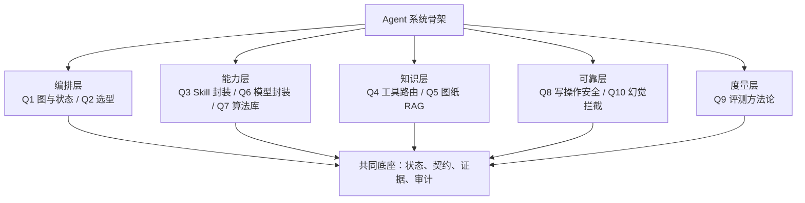

**十题里最重要的一句总纲**（贯穿所有题的答题灵魂）：

> **Agent 的工程质量，取决于你把多少东西从"提示词约束"下沉成"结构性约束"。**

凡是能说出"这里我不是靠 prompt 让他别犯错，而是架构上让他犯不了"的地方，面试官的眼睛会亮。

---

# Q1｜LangGraph 的图与状态是怎么设计的？

## 第一部分：知识点精讲

### 1.1 一句话定义

**LangGraph 把 Agent 建模为"有状态图"**：节点是计算单元，边是状态转移，状态是节点之间传递的可序列化数据。它的核心创新**不是"图"本身**，而是**"持久化执行 + 可重放"**——这让 Agent 从"无状态函数调用"变成了"可恢复、可审计、可长期运行的工作流"。

### 1.2 五个核心构件（必须能脱口而出）

| 构件 | 通俗理解 | 严谨一点的说法 |
|---|---|---|
| **State（状态）** | 一块所有节点共用的"草稿板" | 一个 TypedDict/Pydantic 结构，每个字段是一个 channel |
| **Node（节点）** | 草稿板上写一笔的人 | 一个接收 state、返回**部分更新**的函数 |
| **Edge（边）** | 谁写完给谁 | 固定边 A→B；**条件边**按 state 决定下一步 |
| **Checkpointer（检查点）** | 游戏存档 | 每步结束后把状态快照 + 增量写入持久化后端 |
| **Thread（线程）** | 存档位编号 | thread_id 标识一个隔离的执行上下文 |

### 1.3 三个必须理解的机制

**机制一：Reducer（合并规则）比"状态字段"更重要**

这是新手最容易翻车的地方。状态不是"后写覆盖前写"，而是**按 reducer 规则合并**：

| 合并语义 | 典型用途 | 用错的后果 |
|---|---|---|
| 覆盖（默认） | 当前步骤名、当前预算 | — |
| 追加（append） | 消息列表、工具调用轨迹 | 用成覆盖 → 历史全丢 |
| 自定义合并 | 字典合并、计数累加、取最新版本 | 用成覆盖 → 并发写互相踩 |

**为什么重要**：当多个节点**并发**写同一个字段时，决定"安全"的不是锁，而是 reducer。没有 reducer 的共享写 = 数据静默丢失。

> 类比：草稿板上有两种笔——一种是"擦掉重写"（覆盖），一种是"接着往下写"（追加）。两个人在同一张板上写，如果用同一种擦写笔，先写的就没了。

**机制二：执行模型是 BSP（整体同步并行）**

LangGraph 的执行引擎（Pregel）按**回合（superstep）**推进：收集所有可运行节点 → 并发执行 → 提交写入 → 进入下一回合。理解这点你才能回答"并行工具调用为什么是安全的"以及"一个节点挂了其他节点会怎样"。

**机制三：interrupt 是运行时的一等公民，不是你自己加的标志位**

| 做法 | 暂停点在哪 | 进程崩了会怎样 | 需要额外维护什么 |
|---|---|---|---|
| 状态标记 + 轮询 | 你自己设计的"WAITING"状态 | 崩了就丢，重启后不知道从哪继续 | 额外状态表、额外扫描任务、额外的"续跑"逻辑 |
| **interrupt + Command(resume)** | 运行时记录的打断点，随 checkpoint 一起持久化 | **崩了也能从打断点续跑** | 什么都不用，运行时管了 |

**所以标准答案是**：不用"状态标记 + 轮询"，因为那等于把"暂停—恢复"这个语义在应用层重新实现一遍，而运行时已经把它做成了一等公民，并且能保证"恰好从打断点继续"。

### 1.4 两条硬规则

**规则一：副作用必须放在 interrupt 之后。**

原因：图恢复时会**从被打断的那个节点开头重新执行**。如果"发邮件/扣款/写库"写在 interrupt 之前，恢复时会执行两次。

> 类比：你去银行办业务，"填单子"可以重来（幂等、无副作用），"扣款"不能重来。所以扣款必须放在"柜员叫号确认"之后。

**规则二：State 里不能放不可序列化的对象。**

文件句柄、数据库连接、模型对象都存不进 checkpoint。中断即死。

### 1.5 主流工程实践（2026 年共识）

| 场景 | 主流做法 |
|---|---|
| 开发调试 | 内存检查点，够用 |
| 生产 | **数据库后端检查点**（Postgres 最常见），异步接口，不阻塞事件循环 |
| 多租户 | 把 thread_id 当租户键，一个图服务多用户 |
| 敏感状态 | 加密序列化后再落库 |
| 人工审批 | interrupt 挂起 → 外部处理 → 恢复；**不要自己造轮子** |
| 调试手段 | 历史状态链回放（时间旅行）——改某一步输入，看分支怎么变 |

### 1.6 常见反模式（考官爱问）

1. 把所有逻辑塞进一个节点 → 那你就用不到图，图的收益来自"多节点 + 状态分片 + 条件路由"。
2. 无 reducer 的共享状态并发写 → 静默覆盖。
3. 用内存检查点就上生产 → 重启即丢。
4. State 里放连接对象 → 存不进快照。

### 1.7 落到你的项目

你的项目三处人工介入，全部用 interrupt 建模：**客户确认提案 → 主管审批 → 无法推进时澄清/转人工**。执行前重新读取事实，状态变化会让旧提案失效。

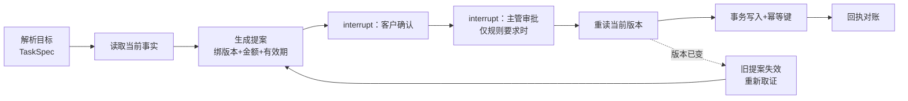

## 第二部分：面试示例回答

> **背诵版（约 90 秒）**

我项目的编排层用的是 LangGraph，我按**五件事**来讲设计。

**第一，State 的 schema。** 我把状态分成四类字段：**目标与计划类**（当前 TaskSpec、目标覆盖清单）、**事实与证据类**（工具观测结果，每条带来源、时间、实体、版本）、**控制类**（当前步骤、预算余量、重规划次数）、**审计类**（事件序列、审批记录）。其中事实类和审计类用**追加语义**合并，绝不能覆盖——因为并发节点会同时写，靠合并规则而不是靠加锁来保证安全。

**第二，节点划分的原则。** 我按"**一个节点一件事、且这件事的输入输出可校验**"来切，而不是按代码模块切。所以有"解析目标""读取事实""证据校验""生成提案""执行写入""回执对账""转人工"这些节点，节点边界和业务审计的边界是对齐的。

**第三，条件边承担全部决策。** 证据有效就走正常路径；证据过期或状态变化就走刷新；可恢复错误进有限修复；预算耗尽或不可恢复就安全停止并转工单。**这个"下一步去哪"的判断是程序化的，不是让模型自由发挥**——模型只在被允许的地方做有限选择。

**第四，检查点。** 用 Postgres 做持久化检查点，把它和业务事件表放同一个权威库。这样服务重启、Worker 被抢占都能从最近的检查点接管；我实测过 Worker 停止后约 **30 秒**被另一个进程接管，执行权用 fencing 标识从 1 递增到 2，中间 28 条事件连续无断裂。

**第五，为什么用 interrupt 而不是自己加状态标记。** 因为"暂停—恢复"在运行时是一等公民：打断点随检查点一起持久化，进程崩了也能从打断点续跑，我不用额外维护"等待表 + 扫描任务 + 续跑逻辑"。同时有一条**硬纪律**：所有不可逆副作用都放在 interrupt 之后——因为图恢复时会从被打断的节点开头重跑，把扣款写在审批之前就等于允许扣两次。

**最后一句总结**：这套设计的价值不是"能跑",而是**"能停、能续、能审、能追"**。

---

# Q2｜Chain、Agent、LangGraph，你分别在什么场景用？

## 第一部分：知识点精讲

### 2.1 三者到底是什么关系

**先纠正一个常见误解**：它们不是三个竞品，而是**同一技术栈的三层**。

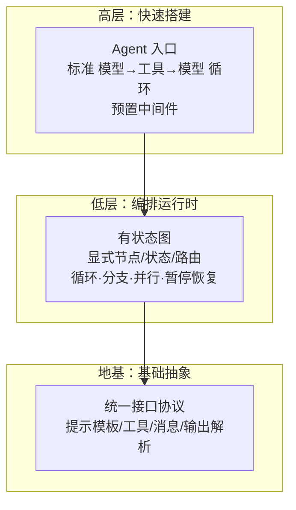

| 维度 | Chain（表达式链） | Agent（标准循环） | Graph（状态图） |
|---|---|---|---|
| **一句话** | 确定性的数据流水线 | 让模型运行时决定下一步 | 显式控制流的编排网络 |
| **有没有环** | 没有 | 有（工具循环） | 有，且由你定义 |
| **状态** | 隐式、不持久 | 默认消息状态 | 完整状态 schema + 合并规则 |
| **人工介入** | 无 | 中间件形式 | 任意节点可暂停 |
| **适合** | 文档问答、摘要、分类、固定 RAG | 标准工具调用 | 长流程、多阶段、审批、多 Agent |
| **类比** | 传送带，工件从头走到尾 | 给工人一套工具，让他自己安排 | 调度中心，能派单、回流、并行 |

### 2.2 三条你必须知道的事实（2026 年版本）

1. **高层 Agent 入口本身就跑在图运行时之上**——也就是说，用最简单的写法也天然继承了持久化和人工介入能力。**"用不用图"和"用不用高层封装"是两个独立问题**，不要混为一谈。
2. **旧的链式写法和旧 Agent 执行器已经废弃**，被移到了独立的历史包里。网上 2023–2024 的教程看到 `LLMChain` `AgentExecutor` 直接跳过。面试时你可以主动提这一点，显示你在跟版本。
3. **图不是可视化低代码工具**。"图"描述的是**执行模型**（一张计算图），不是一个拖拽界面。这是个高频误解，主动纠正能加分。

### 2.3 选型决策树（背下来）

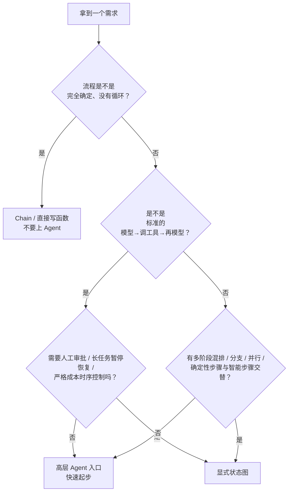

### 2.4 一个更重要的前置问题（说出这句会加分）

> **在选框架之前，先问：这是不是"工作流建模问题"？**

很多需求其实只需要**普通函数调用 + 检索**，硬上框架会引入抽象开销和维护负担。真正的判据是：**你的控制流是否需要表达"循环 / 条件分支 / 中断恢复 / 共享状态"**。如果需要，图是合适的；如果只是一条直线，任何框架都是负担。

### 2.5 常见搭配（不是二选一）

- **高层组件可以作为图里的一个节点复用**——渐进迁移，不用推倒重来。
- 生产上的主流形态是**混合**：主流程用图（显式、可审计），其中"工具循环"这类局部子问题交给高层封装。

### 2.6 落到你的项目

你的项目走的是**"主流程显式图 + 局部受控循环"**：主流程必须沿业务主线走（查询→计划→核证→提案→确认→审批→执行→回执），所以是显式状态机；但每个步骤内部允许受控的局部探索（比如有限重规划）。**这不是"图更好"，而是"高风险任务的流程不允许由模型自由裁剪"。**

## 第二部分：面试示例回答

> **背诵版（约 80 秒）**

我的判断标准是**看控制流，不看功能多少**。三句话：

**第一，流程完全确定、没有闭环的，用表达式链或者干脆直接写函数。** 比如"文档问答"这种一次检索一次生成，上 Agent 是过度设计。判断依据就一条：**你需要不需要表达"循环、条件分支、中断恢复、共享状态"这四个控制流语义中的一个**；一个都不需要，框架就是负担。

**第二，标准"模型→调工具→再模型"循环，用高层 Agent 入口起步。** 因为高层入口本身就跑在图运行时之上，持久化和人工介入能力是天然继承的，不用自己画节点。

**第三，只有这几种情况才值得下降到显式状态图**：多阶段流程里确定性步骤和智能步骤交替；需要严格的分支与并行；需要长时间暂停后恢复（人工审批、跨天任务）；需要对成本和时序做精细控制；或者要做多 Agent 协作。

**落到我的项目**：电商售后的"查询→计划→事实核验→提案→客户确认→主管审批→事务执行→回执对账"是一条**不可被模型自由裁剪的业务主线**——退款这种高风险动作的每一步顺序都有合规含义。所以我的主流程是**显式状态图**，每一个"下一步去哪"的判断由程序完成；只有在单步内部允许受控的局部探索。

**最后补一句选型之外的话**：我觉得比"选哪个框架"更值得先问的是——**这是不是一个工作流建模问题**。如果只是几次接口调用加一次检索，上框架是把简单问题复杂化。这个判断我踩过坑，所以现在会先做这一步筛选。

---

# Q3｜Skill 怎么封装业务流程？粒度怎么定？

## 第一部分：知识点精讲

### 3.1 先分清四个概念（这是本节的地基）

| 概念 | 一句话 | 类比 |
|---|---|---|
| **Tool（工具）** | 一个固定执行能力 | 锤子 |
| **MCP（协议）** | 标准化的连接通道，解决"能访问什么" | 管道 / USB-C |
| **Skill（技能）** | 一段"怎么做"的操作方法与流程 | **施工图纸 / 操作手册** |
| **Sub-agent（子智能体）** | 拥有独立上下文的承包者 | 分包商 |
| **Memory（记忆）** | 存储 | 档案柜 |

**一句话记忆**：**MCP 管"连接（what）"，Skill 管"方法（how）"，Tool 管"执行"，子智能体管"隔离"，记忆管"存"**。

**为什么要有 Skill 而不只是 Tool？** 因为"业务流程"往往不是一次调用能表达的：它有顺序、有条件判断、有验收标准。把这些写进提示词会变成"长篇大论"，写进代码又失去灵活性。Skill 是中间层——**用文档化的流程骨架指导模型，把确定性步骤压进脚本**。

### 3.2 三层渐进式加载（Token 预算的关键设计）

这是 Skill 体系最巧妙的地方：**技能可以有几十个，但上下文不会被撑爆**。

| 层级 | 内容 | 体量建议 | 何时进入上下文 |
|---|---|---|---|
| L1 元数据 | 名字 + 一句话描述 + 触发关键词 | 约 100 token，常驻 | **始终**，用于判断"要不要加载这个技能" |
| L2 主体 | 流程骨架（触发条件、步骤顺序、输出格式、验收标准） | ≤ 5000 token | 描述命中后才加载 |
| L3 资源 | 参考资料、模板、可执行脚本 | 按需，无硬上限但要拆分 | 执行到相关步骤时才读 |

**两个由此推出的硬结论**：

1. **元数据写得模糊，等于这个技能不存在**——因为模型判断是否加载技能的唯一依据就是描述。
2. **一个任务挂太多技能，成功率反而下降**（社区经验：超过 3 个之后开始下滑）。技能不是越多越好，是**越准越好**。

### 3.3 粒度怎么定？——用"可机器检查的契约"当判据

这是本题的**核心答案**。不要把业务拍脑袋切碎或合并，用**七个字段**来判断一个流程块该不该独立成一个 Skill：

| 契约字段 | 要回答的问题 | 为什么必须可机器检查 |
|---|---|---|
| **输入 schema** | 需要哪些参数，类型与约束是什么 | 让程序能在调用前就拒绝非法输入 |
| **输出 schema** | 产出什么结构 | 让下游能稳定消费，不靠自然语言解析 |
| **前置条件** | 什么状态下才能调（设备在线、工单已建、数据已校验） | 组合时避免前置条件冲突 |
| **副作用** | 只读还是写；是否幂等 | 决定是否需要审批与对账 |
| **权限** | 谁能调，作用于哪些资源 | 权限检查必须在模型之外执行 |
| **失败模式** | 有哪些可预期的失败，错误码是什么 | 结构化错误回传给模型，让它能自主调整 |
| **补偿** | 写失败后如何回滚或转人工 | 高风险动作的必要条件 |

**判断规则**：

- 七个字段里有**三个以上说不清** → 说明这块流程还没想明白，**不要包成 Skill**。
- 一个 Skill 的**业务效果不唯一**（比如"查价格"还可能返回订单实付金额）→ **必须拆**，否则模型无法可靠选择。
- 把两个 Skill 合并后，**失败了无法判断是哪一半失败** → 说明该拆。

### 3.4 粒度谱系与典型症状

| 粒度 | 症状 | 后果 |
|---|---|---|
| **过粗**（一个 Skill 干五件事） | 契约写不清、失败无法归因、无法复用 | 模型选了但经常做错；测试无法覆盖 |
| **过细**（把每个接口都包一个） | 编排成本转移到模型；候选数量爆炸 | 模型选择准确率下降；Token 膨胀 |
| **合适** | 契约七字段齐全、效果唯一、可独立测试 | 可组合、可校验、可回归 |

### 3.5 "确定性锁进脚本"原则

Skill 文本应该写**"怎么做"（How），不是"是什么"（What）**。

| 场景 | 错误做法 | 正确做法 |
|---|---|---|
| 校验表头 | 让模型"看一下表头对不对" | 一个校验脚本直接返回通过/不通过 |
| 生成命名 | 让模型自由拼接 | 一个脚本输入前缀输出合规名字 |
| 提交前检查 | 提示词里写"请运行 lint" | 强制串联检查与测试 |

**原则**：凡是"无论谁跑结果都必须一致"的逻辑，全部下沉成脚本；模型只负责**解释失败原因**与**选择下一步**。

### 3.6 反模式清单

1. 把 SKILL.md 写成百科（应该写操作手册）。
2. **让模型自动生成 Skill**——社区经验显示成功率反而下降（生成的是"要遵循最佳实践"这类空话）。
3. 一个任务同时挂载多个 Skill（成功率下滑）。
4. Skill 里做权限检查（必须在模型之外的网关上做）。

### 3.7 实例演练：把"电气设备巡检异常处置"切成 Skill

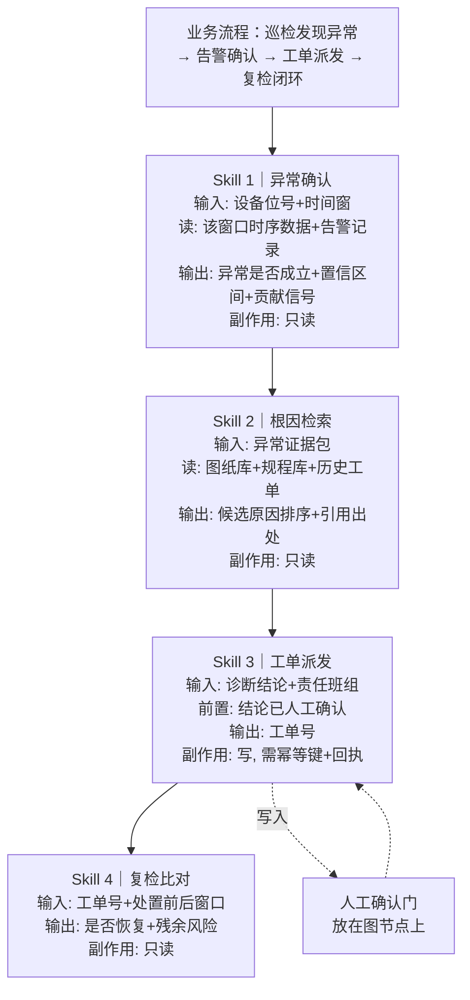

**切分的依据全部来自契约七字段**：Skill 1/2/4 是只读（无副作用），Skill 3 是写（必须幂等 + 回执）；Skill 3 的前置条件"结论已人工确认"是**机器可检查**的（检查确认记录是否存在），所以它不会和其它 Skill 组合冲突。

## 第二部分：面试示例回答

> **背诵版（约 100 秒）**

我讲三个层次：**Skill 是什么、粒度怎么定、边界在哪**。

**第一，Skill 的定位。** 我习惯把工具、协议、技能、子智能体分开看：**工具是执行能力，协议是连接通道，技能是"怎么做"的流程，子智能体是上下文隔离**。技能的独特价值在于它承载的是**流程性知识**——顺序、条件、验收标准，这些既不适合塞进提示词（会变成长篇大论），也不适合硬编码（会失去灵活性）。

**第二，粒度怎么定。** 我不靠感觉切，我用**契约七要素**做判据：输入结构、输出结构、前置条件、副作用、权限、失败模式、补偿。**七个里有三个以上说不清的，说明这块流程还没想明白，不该包成技能**；如果两个流程合并后失败了无法判断是哪一半失败，就必须拆。

**第三，两个具体的切分信号。** 一是**业务效果必须唯一**——如果一个能力既可能返回售价又可能返回实付金额，模型就没法可靠地选它，一定要拆；二是**前置条件必须机器可检查**——这是组合多个技能时不冲突的关键。

**举一个我迁移到贵司场景的例子**：一条"巡检发现异常后走告警确认、工单派发、复检闭环"的流程，我会切成四个技能：**异常确认**（只读，输出异常是否成立和贡献信号）、**根因检索**（只读，输出候选原因排序和引用出处）、**工单派发**（写入，必须有幂等键和回执，前置条件是结论已人工确认）、**复检比对**（只读）。切分依据全部来自契约字段，而不是流程长短。

**第四，一个容易被忽略的工程纪律。** 技能文本应该写"怎么做"，不写"是什么"。凡是"无论谁跑结果都必须一致"的逻辑——命名规则、表头校验、格式化——我都下沉成脚本，**模型只负责解释失败原因和选择下一步**。这样技能的成功率才不会随模型版本漂移。

**最后一句边界**：技能不是越多越好。**一个任务挂载超过三个技能之后成功率会下滑**，所以技能库的验收标准不是数量，是每个技能的可组合性和可测性。

---

# Q4｜工具规模到几千个、描述风格还不统一，你的路由会怎么失效？

## 第一部分：知识点精讲

### 4.1 先建立一个数量级直觉

**工具数量本身就是准确率的敌人**，这是有工程共识的：

| 工具数量 | 常见做法 | 经验准确率区间 |
|---|---|---|
| 少于 10 个 | 描述驱动，全部塞进提示词 | 很高（>95%） |
| 少于 20 个 | 用工具选择参数强制指定 | 高 |
| 20–100 个 | 分层两阶段路由（先分域再选） | 中等（20 个以上常低于 70%） |
| 50 个以上 | 检索式工具选择（把工具当文档检索） | 依赖检索质量 |
| 不限数量 | 训练式路由（小模型分类，毫秒级，但需重训） | 依赖数据 |

**这张表要背下来**，因为它能立刻回答"为什么规模是问题"。

### 4.2 你的四段漏斗长什么样

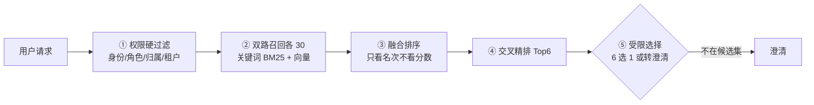

### 4.3 关键区分：**"干扰项"和"近义项"是两种完全不同的敌人**

这是本题的**核心洞察**，也是你最该讲的点。

| 类型 | 举例 | 靠什么解决 | 难度 |
|---|---|---|---|
| **干扰项**（描述上明显不同） | "查询订单" vs "计算定额" | 词法 + 向量召回基本就够 | 低 |
| **近义项**（描述高度相似、业务效果不同） | "查询商品售价" vs "查询订单实付金额"；"试算可退金额" vs "实际退款" | 只能靠**效果唯一化 + 负向描述 + 消歧协议** | **高** |

**你的项目在 1000 项目录上的实验其实就是"干扰项"实验**（40 个真实工具 + 960 个不相关的公开描述），基线和方案都满分，说明的只是"候选池放大 25 倍没有退化"。**真正的难题是近义项**——这一点你必须主动说，否则一旦面试官问"那近义词怎么办"你就被动。

### 4.4 那一段会先失效？逐段分析

| 环节 | 在规模放大 + 描述异质时的表现 | 失效机理 |
|---|---|---|
| ① 权限硬过滤 | **先崩的往往不是算法，是元数据治理** | 如果权限只按粗粒度角色过滤，数千工具里仍会剩下几百个候选进入检索，后面全部承担放大后的噪声 |
| ② 双路召回 | 词法侧对"同义不同词"敏感；向量侧对近义项区分度不足 | 同一效果被不同团队写成"查询/获取/查看/拉取" → 词法漏召；近义描述向量空间几乎重合 → 向量误召 |
| ③ 精排 | 延迟随候选数增长；且**交叉精排最弱的恰恰是近义项** | 精排擅长判"相关性高低"，不擅长判"业务效果是否一致"——两者描述都相关 |
| ④ 受限选择 | 若 Top6 里有两个近义工具，模型退化为**掷硬币** | 候选集内歧义是模型无法通过推理解决的信息缺失 |

**结论顺序**：**有效性上先崩的是①（治理不足导致候选池没收敛）和④（近义歧义）；性能上先崩的是③（精排延迟）**。

### 4.5 改进优先级（从性价比排）

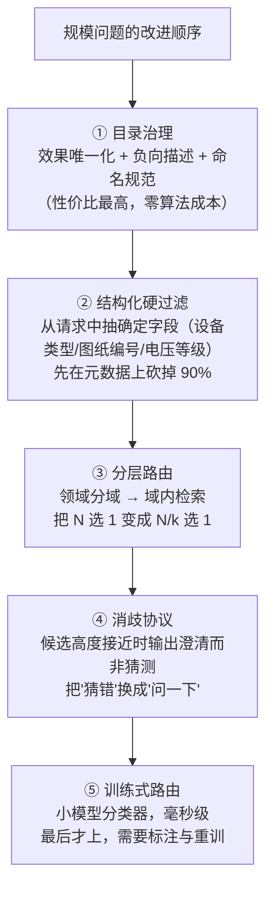

**为什么"目录治理"排第一？** 因为规模问题的本质**不是检索算法不够强，是候选空间没有被正确结构化**。如果一个能力的"业务效果"不唯一，再强的检索也救不了。

### 4.6 消歧协议（最容易被忽略却最有效）

一个可用的工程技巧：**当 Top2 的分数差距小于阈值时，不要让它猜，让它提问**。成本是多一轮交互，收益是把"静默选错"（不可接受的失败）换成"澄清"（可接受的交互）。

### 4.7 落到你的项目

你的项目已经做了这几件对的事，可以指认：

| 机制 | 做法 |
|---|---|
| 效果唯一化 | 每个工具的"效果"字段唯一且等于工具标识，杜绝一能多效 |
| 负向描述 | 描述里显式写"**不做什么**"（如"不是订单实付金额"） |
| 精确匹配优先 | 高频确定性请求走精确效果匹配，**不消耗模型调用** |
| 否定语义不下沉 | 含"不是/不要/无需"的请求强制走语义路由，不用关键词硬猜 |
| 漂移防护 | 路由前比对目录的 schema 哈希与向量元数据，漂移即拒绝执行 |

**这里有一个很好的"自曝边界"**：我主动说——1000 项目录实验里我的方案和强基线打成平手，差值 0，因为**基线已经到样本上限**，所以那个实验只能证明"没有退化"，**不能证明我更准**；而且我在这个规模上 Token 和延迟反而更高。真正的难点我判断是近义工具，那是我下一步要补的（目录治理 + 消歧协议）。

## 第二部分：面试示例回答

> **背诵版（约 110 秒）**

我先给一个判断框架，再逐段说哪里先崩，最后说改进顺序。

**第一，数量本身就是准确率的敌人。** 工程上有比较一致的观察：工具在 10 个以内，把描述全部塞进提示词就够用；20 个以上单纯靠描述选择，准确率会明显下降；50 个以上就要转向"把工具当文档来检索"；再往上要么分层、要么训练小模型做路由。所以规模问题不是"换个更聪明的模型"能解决的。

**第二，我要先区分两种敌人，这决定了方案。** 一种是**干扰项**——描述上明显不相关，检索就能滤掉；另一种是**近义项**——描述高度相似、但业务效果不同，比如"查询商品售价"和"查询订单实付金额"、"试算可退金额"和"实际退款"。**近义项才是真难点**，因为它在向量空间里几乎重合。我在项目里做过的 1000 项目录实验其实属于干扰项实验，方案和基线都是满分、差值 0，只能证明"规模放大 25 倍没有退化"，证明不了更准——这个边界我会主动说明。

**第三，逐段看哪里先崩。** 我的四段是权限硬过滤、双路召回、融合排序、交叉精排，最后是受限选择。**有效性上先崩的是两处**：一是**权限过滤**——如果权限只按粗粒度角色切，几千个工具过滤完还剩几百个，后面全部承担噪声，所以真正先崩的是**元数据治理**，不是检索算法；二是**受限选择**——Top6 里如果出现两个近义工具，模型就退化成掷硬币，因为这是信息缺失，推理救不了。**性能上先崩的是精排**，因为交叉精排的延迟随候选数线性增长，而它恰恰不擅长区分近义项——它只能判"相关不相关"，判不了"业务效果一致不一致"。

**第四，改进顺序。** 我把性价比最高的放第一：**目录治理**——效果唯一化、负向描述（明确写"不做什么"）、命名规范，这是零算法成本的；第二是**结构化硬过滤**，从请求里抽出确定字段（设备类型、图纸编号、电压等级）先在元数据上砍掉九成；第三是**分层路由**，领域分域再域内检索，把"N 选 1"变成"N/k 选 1"；第四是**消歧协议**——候选分差小于阈值就输出澄清而不是猜，把不可接受的"静默选错"换成可接受的"多问一轮"；最后才考虑训练式路由。

**一句话总结**：规模问题的第一解不是更复杂的检索，是**把候选空间结构化**。这也是我在项目里落地"效果唯一化"和"负向描述"的原因。

---

# Q5｜电气/机械原理图的 RAG 该怎么建？

## 第一部分：知识点精讲

> **先坦白**：这是你项目最大的缺口。你的知识库目前只支持纯文本（TXT/Markdown），没有多模态、没有图谱。所以本题的策略是：**承认现状 → 展示你懂这个领域的技术路线 → 给出可落地的方案**。千万不要硬说"我做过"。

### 5.1 为什么图纸 RAG 和文本 RAG 是两件事

一张电气原理图上，"信息"分布在三个层面：

| 层面 | 载体 | 纯文本 RAG 能不能拿到 |
|---|---|---|
| **文字** | 设备型号、位号、参数标注 | 部分能（OCR） |
| **符号** | 断路器、隔离开关、互感器、主变 | **不能**——符号不是文字 |
| **关系（拓扑）** | 谁连谁、经过哪些元件、什么电压等级 | **完全不能**——这是空间与连线关系 |

**一句话**：纯文本 RAG 在制造业文档上的知识覆盖率大约只有 **四到五成**，而多模态路线可以覆盖到 **九成以上**。差距全在图和表里。

### 5.2 三条主流技术路线（必须能对比）

| 路线 | 做法 | 优点 | 缺点 | 成熟度 |
|---|---|---|---|---|
| **A. 图像级多模态** | 整图/图块 → 视觉模型生成结构化描述 → 文本向量库 | 落地快、不依赖 CAD 源文件、扫描件也能用 | **拓扑关系丢失**；长尾符号识别差；描述质量受视觉模型限制 | 高（当前最常见的起步方案） |
| **B. 结构化/CAD 解析** | 解析 DWG/DXF **图层**（符号层/线路层/标注层）→ 图元检测 → 光学识别 → **拓扑重建** → 生成"设备—线路—电压等级"三元组 → 建知识图谱 | 精度高、可推理、可跨图关联 | 依赖 CAD 源文件与符号库；需标注数据；OCR 误差会**级联污染**拓扑 | 中（工业界主力方案） |
| **C. 混合路线（推荐）** | 版面感知解析 → 视觉描述 + 光学识别双路 → 结构化三元组 → **图谱 + 向量双索引** → 检索质量纠错 | 兼顾覆盖率与可推理 | 工程复杂度最高 | 上升中（当前最佳实践） |

**主流工程实现上怎么选？**
- 只有扫描件/PDF、没有 CAD 源文件 → 从 **A** 起步，用视觉模型 + 版面感知解析。
- 有 DWG/DXF 源文件且是核心资产 → 必须走 **B**，因为图纸的价值就在拓扑。
- 两者都有 → 走 **C**：视觉路线兜覆盖率，图谱路线兜精度。

### 5.3 五段式流水线（可以直接讲给面试官听）

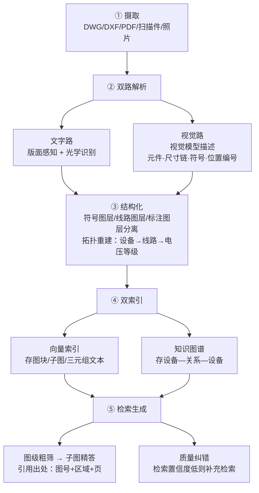

**第 ⑤ 步的"质量纠错"值得单独说**：在检索器和生成器之间加一层质量评估，如果检索结果相关性弱，就触发纠正动作——补充检索、查历史记录、或直接建议转人工。这是工业场景防止"级联错误"的标准做法。

### 5.4 核心问题：**向量化的基本单位是什么？**

这是面试官最可能追问的点，也是一道有清晰答案的题。**答案是：多粒度并存，不是选一个。**

| 向量化单位 | 优点 | 缺点 | 该回答什么类型的问题 |
|---|---|---|---|
| **整张图** | 保留全局；实现最简单 | 粒度粗、噪声大、无法定位 | "**找图**"——哪张图纸和这个相关 |
| **图块/区域** | 平衡；可定位到区域 | 需要版面分割 | "这个区域的接线是怎么走的" |
| **元件/符号** | 精确、可做参数查询 | 丢上下文 | "这个型号的额定电流是多少" |
| **子图/回路** | **保留拓扑语义**，最适合推理 | 需要拓扑重建能力 | "主变高压侧的隔离设备有哪些" |
| **关系三元组** | 可多跳推理 | 抽取错误会污染图谱 | "这个设备故障会影响哪些回路" |

**工程主流做法**：**粗筛用整图，精答用子图/元件，推理走三元组**——用"小块检索、大块交付"的父子结构把几层串起来。单纯只做一层，效果一定偏科。

### 5.5 跨图引用怎么表达？（难度最高的一问）

电气图纸的一个回路经常会引用另一张图的端子或另一张装配图的零件。三种做法：

| 做法 | 机制 | 适用 |
|---|---|---|
| **统一标识符锚点** | 用设备位号/系统编码做全局唯一锚点 | **首选**——凡是设备有统一编码体系的场景 |
| **显式关系建模** | 把"图A端子X → 引用 → 图B回路Y"建成图谱里的一条边 | 需要跨图推理时 |
| **文档级元数据** | 只标注"这几张图属于同一套"，检索时整组召回 | 兜底方案，粒度粗 |

**标准答法**：优先用**设备位号/编码做全局锚点**，检索命中一个节点后**沿图谱扩展一跳**，把跨图引用带进来。这样既不依赖图纸排版，也不需要先全量重建拓扑。

### 5.6 评测怎么建（这一问常常是杀手）

| 题型 | 期望产出 | 指标 |
|---|---|---|
| 图级 | 定位到正确的图纸 | 召回@K |
| 区域级 | 定位到图上正确区域 | 区域命中率 |
| 元件级 | 返回正确参数 | 精确率 |
| **跨图/推理级** | 返回正确的引用链或影响范围 | **拓扑正确率（三元组 F1）** |

**关键点**：图纸 RAG 不能只用文本那套召回/精确率指标，**必须补一个"拓扑正确率"**——因为"找到了对的图但连错了线"在电气场景是危险的错误，比"没找到"更糟。

### 5.7 必须主动说的三个边界

1. **符号库与标注数据稀缺是最大障碍**，而且跨领域泛化差。
2. **OCR 误差会级联污染拓扑重建**——文字识别错一个位号，连出来的线就是错的。
3. **通用视觉模型对行业符号的长尾识别不可靠**，高价值场景需要专用检测模型 + 人工抽检。

## 第二部分：面试示例回答

> **背诵版（约 120 秒）**

**先说明我的现状，避免误导**：我现在的知识库只支持纯文本，做的是电商客服场景，所以图纸 RAG 我还没有落地经验。但我研究过工业图纸这条线的技术路线，我把我的判断讲一下。

**第一，图纸 RAG 和文本 RAG 的本质差别。** 图纸的信息分三层：文字、符号、**拓扑关系**。纯文本 RAG 只能拿到第一层的一部分——制造业文档里，纯文本路线的知识覆盖率大概只有四五成，而多模态能到九成以上，差距全在图和连线里。所以我不会试图用"更好的图像描述"去糊弄，因为**拓扑关系不是描述能表达的**。

**第二，三条路线我会怎么选。** 一是**图像级多模态**——整图或图块交给视觉模型生成结构化描述，进文本向量库，落得快、能处理扫描件，但拓扑丢失、长尾符号识别差；二是**结构化解析**——解析 CAD 的图层，把符号层、线路层、标注层分开，做图元检测和光学识别，再用**拓扑重建**生成"设备—线路—电压等级"的三元组，建知识图谱，精度高但依赖源文件和符号库；三是**混合**。我的选择标准是：**有 DWG/DXF 源文件就必须走结构化路线**，因为图纸的价值就在拓扑；只有扫描件就先从图像路线起步。

**第三，向量化的单位我建议多粒度并存，不是选一个。** 整图做粗筛（回答"哪张图相关"），图块做定位，元件做参数查询，**子图/回路做推理**（回答"主变高压侧有哪些隔离设备"），三元组做多跳。工程上主流的做法是"**小块检索、大块交付**"——用子块命中、拿父块喂模型。我特别强调**子图级**，因为纯元件级会丢拓扑、纯整图会丢精度。

**第四，跨图引用。** 我优先用**设备位号或系统编码做全局锚点**，检索命中后沿图谱扩一跳把跨图引用带进来。这样不依赖图纸排版，也不用先全量重建拓扑。

**第五，评测。** 图纸 RAG 不能只报召回率，必须补一个**拓扑正确率**——因为"找到对的图但连错线"在电气场景比"没找到"更危险。所以我会分四类题型评测：图级、区域级、元件级、跨图推理级，最后一类的指标是关系三元组的 F1。

**最后主动说边界**：这条线最大的障碍是符号库和标注数据稀缺，以及光学识别误差会级联污染拓扑——所以高风险结论我会保留人工抽检，不会让 Agent 直接出最终结论。

---

# Q6｜时序分析小模型该怎么封装进 Agent？

## 第一部分：知识点精讲

> **再次坦白**：你的项目目前只有"远程 LLM 调用封装"和"固定计算沙箱"，**没有自训时序模型**。所以同样是"承认 → 讲原理 → 给方案"。

### 6.1 为什么需要一个"小模型"，而不是让大模型算

| 维度 | 大语言模型 | 时序小模型 |
|---|---|---|
| 擅长 | 理解意图、编排任务、解释结果 | 数值计算、趋势/周期/突变识别、异常评分 |
| 数值精度 | **不可靠**——不能让它算精确数值 | 确定、可复现 |
| 延迟与成本 | 高 | 毫秒级、可离线 |
| 可解释性 | 弱 | 强（可给出贡献信号、置信区间） |
| 版本稳定性 | 会漂移 | 版本钉死后完全确定 |

**核心分工原则**（一定要说）：

> **让语言模型负责"编排与解释"，让专业模型负责"算数与判定"。**

**为什么这条原则重要**：如果让语言模型自己算设备健康指数或做趋势预测，你得到的是一个**无法复现、无法审计、无法校准**的数字——在工业场景这是不可接受的。

### 6.2 封装的七要素契约（把 Skill 那套直接迁移过来）

| 契约字段 | 时序模型特有要求 |
|---|---|
| **输入 schema** | 设备/测点标识、**时间窗**、**采样率假设**、通道数、单位 |
| **输出 schema** | 分数/标签/预测序列 + **置信区间** + **贡献最大的信号** |
| **前置条件** | 数据质量必须通过（缺测率、量程校验、时间戳单调） |
| **副作用** | **必须只读**——分析类能力不应写数据 |
| **权限** | 按设备/区域/租户限定可见范围 |
| **失败模式** | 超时、输入不足、模型不可用、输出不合 schema、数据漂移 |
| **补偿** | 降级到确定性算法、或标记为不可用并转人工 |

**额外三个必带字段（时序特有）**：**模型版本、特征版本、训练数据窗口**。没有这三个，你的结果无法追溯，也无法判断"结果变了是因为数据变了还是模型变了"。

### 6.3 三种失败必须分别处理（这一问的实质考点）

| 失败 | 错误做法 | 正确做法 |
|---|---|---|
| **推理超时** | 无限重试，或者让模型"估算一下" | 设置超时 → 超时后**降级到确定性算法**（阈值/统计量）→ 兜底给的是"保守结论"而不是"猜" |
| **返回不可解析** | 让模型自己"补全"缺失字段 | **输出 schema 校验**；校验失败保留原始输出 + 标记为降级；**绝不让语言模型编造数值** |
| **模型版本变更** | 静默升级 | 版本**钉死**（镜像摘要级别）；输出必须带版本标识；任何升级都要跑回归；**缓存键必须包含模型/特征/窗口配置** |

**为什么缓存键要包含模型和特征版本？** 因为这和"前缀缓存错误命中"是同一类问题——如果缓存键只用了"设备+时间窗"，换模型后会把旧模型的结论当成新模型的结论返回，这是**静默错误**。

### 6.4 核心判断题：做成 Skill 还是做成图节点？

这题没有唯一答案，**给判据比给结论更好**：

| 判据 | 做成 Skill/工具 | 做成图节点 |
|---|---|---|
| 调用时机 | 需要模型**按场景灵活选择组合** | **流程固定、必须执行** |
| 顺序要求 | 无严格先后 | 有严格顺序（先质检→再检测→再定级） |
| 失败处理 | 失败可换别的工具 | 失败必须中断或转人工，需要检查点 |
| 复用性 | 被多个流程复用 | 专属于某条流程 |
| 举例 | "算频谱特征""算健康指数""做趋势预测" | "数据质量门""异常确认门""人工复核门" |

**主流工程实现是混合**：

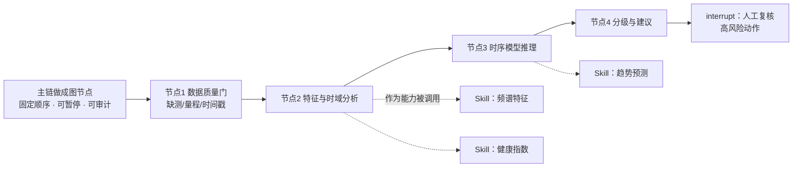

**一句话**：**固定主链做成图（保证顺序、可暂停、可审计），可组合的算数能力做成 Skill（供模型按场景选择）**。两者不是竞争关系。

### 6.5 部署形态与漂移治理

| 议题 | 主流做法 |
|---|---|
| 部署 | 模型作为**独立微服务/容器**（推理服务化），Agent 只通过契约调用，不把模型塞进 Agent 进程 |
| 位置 | 靠近设备的分析放在**边缘侧**降低延迟和网络依赖；重分析放云端/中心 |
| 性能 | 时序数据量极大，需考虑批量与批流分离；保留降级机制 |
| **漂移** | 监控**数据漂移与概念漂移**（工况变化不等于故障）；定期重训；新旧版本**影子对比**后再切换 |
| 安全 | 高风险动作只给建议不给控制；每一次调用、判断、执行留审计记录 |

### 6.6 落到你的项目（同构点）

你的项目里其实已经有一个**同构做法**：把"十进制定额计算、CSV 摘要、文本统计"这类**必须结果一致**的能力放进**独立沙箱进程**，无网络、只读根文件系统、资源限额，Agent 只能通过固定契约调用。**时序模型的封装可以把这套"隔离 + 契约"的思路直接复制**——只是把沙箱里的确定性算法换成模型推理服务。

## 第二部分：面试示例回答

> **背诵版（约 110 秒）**

**先说明现状**：我的项目里没有自训时序模型，但我做过"专业能力封装"这件事——我把必须结果一致的确定性计算放进了独立的隔离进程，通过固定契约调用。这个思路迁移到时序模型，我认为是一样的，我讲四点。

**第一，分工原则。** **让语言模型负责编排与解释，让专业模型负责算数与判定。** 我不会让语言模型去算设备健康指数或做趋势预测——那样得到的是不可复现、不可审计、不可校准的数字。这不是能力问题，是**工程约束问题**。

**第二，封装契约。** 我要求七要素齐全：输入结构（设备标识、时间窗、**采样率假设**、通道数、单位）、输出结构（分数或预测 + **置信区间** + **贡献最大的信号**）、前置条件（数据质量门）、副作用（**必须只读**）、权限、失败模式、补偿。另外我额外带三个字段：**模型版本、特征版本、训练数据窗口**——没有这三个，结果变了你没法判断是数据变了还是模型变了。

**第三，三种失败我分别处理。** 一是**推理超时**：设超时，超时后**降级到确定性算法**，兜底给的是保守结论而不是让语言模型猜；二是**输出不可解析**：做输出结构校验，失败就保留原始输出并标记降级，**绝不让语言模型补全数值**；三是**模型版本变更**：版本钉死、输出带版本标识、升级必须跑回归，而且**缓存键必须包含模型与特征版本**——否则换模型后会把旧结论当新结论返回，这是静默错误。

**第四，做成技能还是做成节点，我给判据不给定论。** 如果这段能力需要模型**按场景灵活选择组合**、没有严格顺序要求、失败还能换别的工具，就做成可组合的技能；如果它**流程固定、必须执行、有严格顺序、失败必须中断或转人工**，就做成图里的节点，因为节点才有检查点和暂停能力。**主流做法是混合**：固定主链做成图节点（如数据质量门→分析→推理→分级→人工复核），可组合的算数能力做成技能供模型选择。

**最后说两点工业场景的必要约束**：一是高风险动作**只给建议不给控制**，涉及设备参数调整必须有权限分级和人工确认；二是**漂移治理**——工况变化不等于故障，所以我要监控数据漂移与概念漂移，定期重训并做影子对比，同时把现场人员的确认和驳回纳入反馈闭环。

---

# Q7｜Agent 算法库应该沉淀什么？怎么组织？

## 第一部分：知识点精讲

### 7.1 先定义清楚"算法库"是什么

**它不是一个代码仓库，而是一组"可被机器理解与组合的能力契约"。**

这个定义很关键。如果只是"把代码放一起"，那叫代码复用；算法库的价值在于**让模型知道有哪些能力、什么时候用、怎么组合、失败怎么办**。

### 7.2 组织维度之争：按算法族，还是按能力？

这是面试官最可能直接问的一句。

| 组织维度 | 例子 | 优点 | 缺点 |
|---|---|---|---|
| **按算法族** | ReAct / Plan-Execute / Reflection / 多智能体 | 概念清晰、贴近文献 | **业务代码不是按算法写的**，复用困难 |
| **按能力/职责** | 检索 / 规划 / 校验 / 恢复 / 记忆 | 直接对应工程问题、可组合 | 边界模糊，容易膨胀 |
| **按领域 + 契约**（推荐） | 域：图纸解析 / 时序分析 / 工单；每个域内按统一契约描述 | 既复用又可组合、可校验 | 需要前期治理投入 |

**主流工程实现是"三层叠加"**：

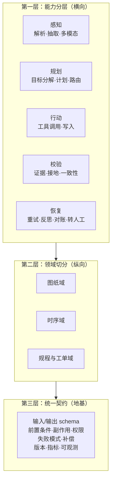

**一句话**：**横向按能力分层，纵向按领域切分，底座用统一契约**。

### 7.3 沉淀到什么程度才算"可复用"？

这是本题的**核心考点**。给你一份**七条验收清单**，能逐条对上就是可复用：

| # | 验收项 | 不合格的样子 |
|---|---|---|
| 1 | 有机器可检查的输入输出结构 | 输入靠自然语言描述 |
| 2 | 有前置条件与副作用声明（读/写、幂等否、权限范围） | 不说清是读还是写 |
| 3 | 有失败模式枚举 + 错误码 + 建议动作 | 只会返回"失败" |
| 4 | 有独立测试与验收标准 | 靠人工点一遍 |
| 5 | 有版本号与变更策略（**结构变更加版本后缀，不改已有签名**） | 直接改字段，下游全崩 |
| 6 | 有量化指标（P99 耗时、成功率、降级次数、命中率） | 无法回答"它快不快、准不准" |
| 7 | 有可观测（追踪标识、调用量、成本） | 线上出问题定位不了 |

> 特殊提醒第 5 条：**接口结构与签名的变更策略，是算法库里最容易埋雷的地方**。工具结构变更是最常见的破坏源——正确做法是"加新版本后缀，不动老签名"。

### 7.4 反模式清单（说出这些很加分）

| 反模式 | 为什么错 |
|---|---|
| 把流程文档写成"知识百科" | 应该是操作手册，写步骤和验收标准 |
| **让模型自动生成能力条目** | 社区经验：自动生成的成功率反而**下降**——生成的是"要遵循最佳实践"这类空话 |
| 一个任务挂载过多能力 | 超过三个之后成功率下滑 |
| 把权限检查写在能力内部 | 权限必须在**模型之外的网关**上执行，因为代码可能被注入绕过 |
| 以数量考核库的建设 | 数量不是指标，**可组合性与可测性**才是 |

### 7.5 与"技能/MCP"的关系（收束）

- **MCP** 解决"能访问什么"（连接）
- **Skill** 解决"怎么做"（方法）
- **算法库**是这两者的**上游沉淀层**：它定义契约与版本，Skill 与 MCP 是它的两种发布形态（一种是文档式的流程，一种是接口式的连接）

### 7.6 落到你的项目

你的 40 个商家工具已经是**算法库的雏形**，可以指认的对应关系：

| 算法库要素 | 你项目的对应实现 |
|---|---|
| 能力契约 | 每个工具一个参数模型，含正则与长度约束 |
| 效果唯一化 | 效果标识唯一，杜绝一能多效 |
| 发布方契约 | 由发布方决定能力的业务效果投影，**不用不可信的描述做裁剪依据** |
| 读写分级 | 只读能力可被检索命中；写能力只能由绑定提案的执行路径触发 |
| 变更防护 | 目录结构哈希与向量元数据比对，漂移即拒绝执行 |
| 结构化错误 | 错误码 + 参数注入探针（40 工具 × 5 类注入全部被拒） |

**下一步要补的**：把"应用内的模块"抽成"独立版本化的库"，并补上第 6、7 条（量化指标与可观测）。

## 第二部分：面试示例回答

> **背诵版（约 100 秒）**

我分三点讲：**组织维度、验收标准、和上下层的关系**。

**第一，组织维度我不按算法族，也不纯按能力，而是三层叠加。** 理由是这样：纯按算法族（ReAct、Plan-Execute、Reflection）组织，概念上很清晰，但**业务代码不是按算法写的**，最后会发现每个算法底下只有一两个使用点，复用不起来；纯按能力组织又容易边界模糊。我的做法是——**横向按能力分层：感知、规划、行动、校验、恢复**，这五类基本穷举了 Agent 需要的能力；**纵向按领域切分**，比如图纸域、时序域、规程与工单域；**底座是统一契约**。这样横向可组合、纵向可归属。

**第二，沉淀到什么程度算可复用，我用七条验收清单。** 一，有机器可检查的输入输出结构；二，有前置条件与副作用声明，说明是读还是写、是否幂等、权限范围；三，有失败模式枚举和错误码，而且错误要能**回传给模型**让它自主调整；四，有独立测试和验收标准；五，**有版本号和变更策略——结构变更要加版本后缀，不改已有签名**，这是算法库里最容易埋雷的地方，工具结构变更是最常见的线上破坏源；六，有量化指标，P99 耗时、成功率、降级次数、命中率；七，有可观测。**这七条里缺任何一条，我都不认为它是"已沉淀"的能力。**

**第三，和上下层的关系。** 我觉得算法库是上游沉淀层：它定义契约与版本，向下有两种发布形态——**文档式的流程发布成技能，接口式的连接发布成协议服务**。所以我不把它们看成竞争关系。

**最后说两个反模式**。一是**不要让模型自动生成能力条目**——社区经验是自动生成的成功率反而下降，因为产出的是空话；二是**权限检查不能写在能力内部**，必须在模型之外的网关上做，因为能力代码本身可能被注入绕过。

**落到我的项目**：我的 40 个工具其实就是算法库的雏形——每个有参数契约、有效果唯一化、有发布方契约决定业务效果、有读写分级（只读能力才能被检索命中，写能力只能由绑定提案的执行路径触发）、有结构漂移防护。**下一步我要补的正是第 6、7 条：量化指标与可观测，以及从"应用内模块"抽成"独立版本化的库"。**

---

# Q8｜如果外部系统既不幂等、也不提供回执，写操作怎么办？

## 第一部分：知识点精讲

### 8.1 先看清楚你的"武器"在什么前提下有效

标准的写操作安全依赖四件套：

| 机制 | 作用 | 前提 |
|---|---|---|
| 幂等键 | 同样的请求重复发只生效一次 | **对端支持幂等键** |
| 唯一约束 | 数据库层面防重复记录 | 你控制数据库 |
| 状态机 | 只允许合法状态迁移 | 你控制状态 |
| **回执对账** | 结果不确定时查证真实结果 | **对端提供查询接口** |

**所以 SCADA/PLC 上位机这个场景的难点在于：最后两件武器失效了**——没有幂等接口，也没有回执查询，还"发出去就不管"。

### 8.2 核心认知（这句话是本题的答题灵魂）

> **当外部系统不可控时，一致性责任必须内移到我们这一侧。而且第一件事不是"怎么重发"，是"选择可接受的失败语义"。**

也就是说，你要先回答一个问题：**"多写一次"和"少写一次"，哪个后果更严重？** 在电气场景，这两者可能都不可接受，那么正确结论就是**不允许自动写**。

### 8.3 五层方案（按可靠性递增，也是按推荐度递增）

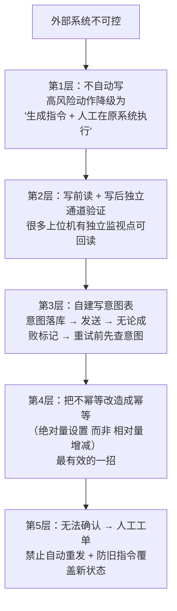

**逐层解释**：

**第 1 层：不自动写。** 这是工业场景最常见的正确答案，也是最容易被面试者忽略的**成熟答案**。数据整理、异常筛查、报告生成可以高自动化；故障诊断和参数调整需要人工复核；涉及设备控制和生产参数的动作必须严格权限 + 人工确认。**"Agent 只给建议不给控制"不是能力不足，是安全边界的正确设计**。

**第 2 层：写前读 + 写后独立通道验证。** 写之前先读当前值作为基线；写之后**通过另一个通道**（独立的监视接口、另一个数据点、历史趋势）回读目标值，用"实际状态是否等于期望状态"来判断是否成功。这在你没有回执查询时，是最接近回执的替代品。

**第 3 层：自建写意图表。** 在你这一侧维护一张"写意图"记录：**意图标识 + 目标点 + 期望值 + 状态**。关键是**发送前先落库**，发送后无论成败都更新状态；重试之前先查这条意图——如果已经处于"已发送未确认"，就先去验证而不是直接重发。这本质上是在**我们侧重建一个"可查询的回执"**。

**第 4 层：把不幂等改造成幂等（最有效）。** 这是我认为最漂亮的一招：

| 不幂等的写法 | 改造后 |
|---|---|
| "把功率提高 10%" | "把功率设为 80%" |
| "增加两小时运行时间" | "把结束时间设为 14:00" |
| "追加一条记录" | "用去重标识写入这条记录" |

**原理**：相对量操作天生不幂等（重发就等于多做一次）；**绝对量设置天生幂等**（重发等于把同样的值再设一遍）。所以在设计接口或选择指令时，**优先选择绝对量语义**——这比任何补偿机制都可靠。

**第 5 层：补偿与人工兜底。** 无法确认时进入人工工单，**禁止自动重发**。同时要注意**陈旧指令覆盖新状态**的问题：如果你用"执行权标识"来防止旧进程覆盖新状态，那么一条延迟到达的旧指令也可能覆盖新值——所以需要带**时序或序列号**做新旧判定。

### 8.4 还有两招来自"老系统的历史包袱"

老系统往往本来就有一些防重复机制，可以被利用：

| 机制 | 怎么用 |
|---|---|
| 报文序列号 | 如果协议带序列号，重发时复用同一个序列号，对端可能自动去重 |
| 时间戳窗口 | 很多系统会丢弃过期报文，可利用它做天然去重 |
| 建议值回读 | 有些系统"设置"接口会返回实际生效值，那其实就是一个弱回执 |

### 8.5 对比总结

| 场景 | 能不能自动重发 | 首要手段 |
|---|---|---|
| 有幂等接口 + 有回执 | 能 | 幂等键 + 回执对账 |
| 有回执、无幂等 | 谨慎 | 先查回执再决定 |
| **无幂等、无回执** | **不能** | **绝对量改造 + 我们自己侧维护写意图 + 独立通道验证 + 人工兜底** |

### 8.6 落到你的项目

你的项目用的是标准四件套（操作标识 + 参数哈希 + 唯一约束 + 合法状态迁移 + 回执对账）。面试时**讲完项目，再主动讲迁移**：

> **迁移到 SCADA 场景，我会把方案反过来：不是靠对端给回执，而是靠"把不幂等改造成幂等 + 在我们侧自建可查询的写意图 + 独立通道写后验证 + 高风险动作不自动写"。**

## 第二部分：面试示例回答

> **背诵版（约 100 秒）**

**先给结论**：在这种场景下，我认为**第一件事不是设计重试，而是确定可接受的失败语义**——先回答"多写一次"和"少写一次"哪个后果更严重。如果两者都不可接受，那正确结论就是**不允许自动写**。我把方案分成五层。

**第一层，也是我最推荐的：高风险动作不自动写。** 工业场景里这个是成熟答案不是能力妥协——数据整理、异常筛查、报告生成可以高自动化；故障诊断和参数调整要人工复核；涉及设备控制和生产参数的动作必须权限分级加人工确认。**Agent 只给建议不给控制**，这是安全边界的正确设计。

**第二层，写前读、写后走独立通道验证。** 写之前先读当前值当基线，写之后通过**另一个通道**回读目标值——很多上位机有独立的监视点或历史趋势，用"实际状态是否等于期望状态"来判断成功。这在没有回执接口时是最接近回执的替代品。

**第三层，在我们这一侧自建"写意图表"。** 记录意图标识、目标点、期望值和状态；关键是**发送前先落库**，发送后无论成败都更新状态；重试之前先查这条意图，如果已经处于"已发送未确认"，就先验证而不是直接重发。本质上是**在我们侧重建了一个可查询的回执**。

**第四层，也是我认为最有效的一招：把不幂等改造成幂等。** 相对量操作天生不幂等——"提高 10%"重发就等于多提一次；但**绝对量设置天生幂等**——"设为 80%"重发等于再设一遍同样的值。所以在接口设计和指令选择上，我会**优先选绝对量语义**，这比后面加任何补偿机制都可靠。

**第五层，补偿与人工兜底。** 无法确认就进人工工单，**禁止自动重发**；同时要注意**陈旧指令覆盖新状态**——延迟到达的旧指令可能覆盖新值，所以要带时序或序列号做新旧判定。

**最后补充一点**：老系统往往本来就有防重复机制可以利用——比如协议自带报文序列号，重发时复用同一个序列号；或者系统会丢弃过期时间戳的报文，那就是天然去重窗口。

**落到我的项目**：我用的是标准四件套——操作标识、参数哈希、唯一约束、合法状态迁移加回执对账。**迁移到贵司这种无幂等、无回执的场景，我会把方案反过来：不依赖对端给回执，而是靠"绝对量改造 + 自建写意图 + 独立通道验证"，并把高风险动作挡在自动执行之外。**

---

# Q9｜为什么不能用准确率？区间包含 0 意味着什么？

## 第一部分：知识点精讲

### 9.1 为什么传统准确率在这里不够用（五条理由）

| # | 问题 | 后果 |
|---|---|---|
| 1 | **样本不独立** | 同一个场景跑多次是**重复测量**，不是新样本。按"次数"算样本量会把有效的独立样本数**虚高好几倍** |
| 2 | **任务族分布不均** | 某类任务样本多，就会主导总体准确率——"总体 88%"可能掩盖某类任务只有 40% |
| 3 | **分母口径混杂** | 把"永久故障的安全停止"和"无故障对照"这类**不该计入的样本**混进分母，数字就失去意义 |
| 4 | **二值口径掩盖失败类型** | "任务显示成功"不等于"业务上正确"——真正要看终态、作用范围、证据时效、工具效果、回执一致性 |
| 5 | **没有不确定性度量** | 只报一个点估计，无法判断"提升"是真提升还是噪声 |

**由此推出三个必须替换的口径**：

| 替代口径 | 解决上面哪个问题 |
|---|---|
| **严格成功**（不看"显示成功"，看隐藏约束是否全部满足） | 问题 4 |
| **family 均衡率**（先按任务族算，再对族取平均） | 问题 2 |
| **分层分母**（控制组单独统计，不混入主分母） | 问题 3 |

### 9.2 聚类 Bootstrap 到底解决什么

这是本题的**技术核心**，要讲清楚原理。

**普通 bootstrap** 的做法：从样本里**有放回地重采样**，重复很多次，得到统计量的分布，从而给出置信区间。它的隐含假设是——**每个样本相互独立**。

**问题在于**：你的数据是"任务族 → 多个 trial"的两层结构。同一个族里的多个 trial 高度相关（同一个场景的重复测量）。如果按单个样本重采样，就等于**把相关的东西当独立的东西**，结果是**置信区间过窄**——区间看起来很小、很显著，其实是**假阳性**。

**聚类 bootstrap 的做法**：**以"簇"（任务族）为单位**做有放回重采样，保持簇内样本一起进出。因为同一簇内部的相关性被完整保留，估计出来的方差才是**诚实的**。

**配对聚类 bootstrap**（你项目用的）：对同一个簇，把两个方案（方案与基线）的**差值**一起重采样，直接得到"差值的分布"，据此给出差值的置信区间。配对的好处是**消掉簇间基线差异**，让比较更敏感。

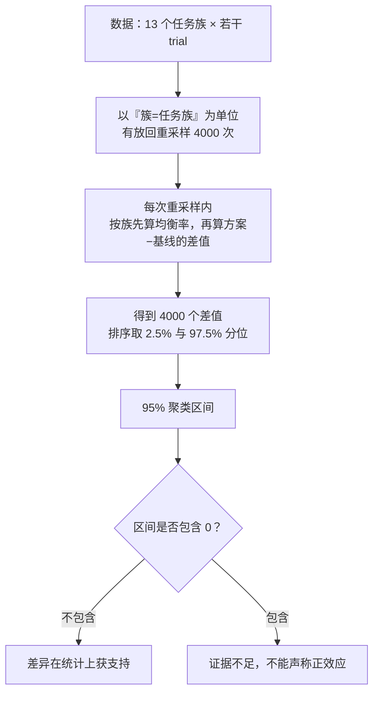

### 9.3 区间包含 0 意味着什么？（最容易答错的一问）

**三个层次，必须分开说**：

| 说法 | 对不对 |
|---|---|
| "区间包含 0，所以我的方案没用" | ❌ **错**。这是最常见误解 |
| "区间包含 0，所以实验失败了" | ❌ **错**。这是"证据不足"，不是"证明无效" |
| "**区间包含 0，说明观测到的差异在统计上无法排除『无差异』，因此不能声称总体正效应**" | ✅ **对** |

**为什么区间会包含 0？** 三个可能原因：
1. **样本量不足**（统计功效低）——真实的效应存在，但你的样本还不足以把它从噪声里分辨出来；
2. **簇内方差大**——同一场景多次运行波动很大；
3. **效应确实很小**——真实提升就接近于零。

**所以正确的表述方式**：
- 可以写："点估计达到 +8pp 目标，但 95% 区间包含 0，**不能声称总体正效应**。"
- 不能写："提升了 8pp。"（这是把点估计当结论）

**比"区间是否含 0"更强的判据**：看**区间下界是否高于目标值**。如果区间下界本身就高于预登记的目标门槛，那么结论比"区间不含 0"还要强。

### 9.4 配套的四个方法论要求（说出这些是"研究型候选人"的信号）

| 要求 | 作用 |
|---|---|
| **预登记** | 先写下假设、口径、门槛，再看数据——防止事后挑指标、挑样本 |
| **分母分层** | 控制组（永久故障、无故障对照）单独统计，不混入主指标 |
| **失败样本原样保留** | 不删失败批次，不因为"这轮不好看"重跑 |
| **多指标联合判据** | 要求"差值达标"**且**"绝对质量达标"**且**"区间不含 0"同时成立，避免单指标达标的假成功 |

### 9.5 一个非常好用的加分点：区分"点估计达标"与"统计获支持"

你的项目里有一组很漂亮的对照可以讲：

| 比较 | 点估计 | 区间 | 结论 |
|---|---|---|---|
| 主指标（方案 vs 强基线） | +9.14pp，达到预登记目标 | **包含 0** | 点目标达到，**但未获统计支持** |
| 消融（方案 vs 关掉核心机制） | +8.56pp | **不含 0** | **获支持** |
| 另一维度（方案 vs 向量历史基线） | +75.64pp（family 均衡口径：100% − 24.36%） | 不含 0，下界远高于目标 | 获支持 |

> 讲这一行时要额外说明：基线的**任务级**成功率是 62/180（34.44%），**family 均衡率**是 24.36%，`+75.64pp` 对应后者。若用 34.44% 去减会得到 65.56pp，那是混用了口径——主动指出这一点，比等着被追问更有利。

**这三行放在一起讲，会让面试官觉得你真的懂统计，而不是把数字当装饰。**

### 9.6 还有一句可以主动说的边界

> **区间给我的是"证据强度"，不是"业务价值"。** 而且我的评测是**冻结的模拟场景**，没有独立人工盲审，所以结论不能外推到真实生产或任意攻击条件。

## 第二部分：面试示例回答

> **背诵版（约 110 秒）**

我分三层：不能用准确率的原因、聚类 bootstrap 解决什么、区间含 0 怎么解释。

**第一，为什么用严格成功和族均衡率，不用准确率。** 有五个原因。**一，样本不独立**——同一个场景跑多次是重复测量，不是新样本，按次数算样本量会把独立样本数虚高好几倍。**二，任务族分布不均**——某类任务样本多就会主导总体数字，"总体 88%"可能掩盖某类只有 40%。**三，分母口径混杂**——永久故障的安全停止、无故障对照这些不该计入的样本如果混进分母，数字就没有意义，所以我单独统计。**四，二值口径掩盖失败类型**——"任务显示成功"不等于业务正确，要看终态、作用范围、证据时效、工具效果和回执一致性，所以我用的是"严格成功"。**五，只报点估计没有不确定性度量**，无法判断提升是不是噪声。

**第二，聚类 bootstrap 解决的是"把相关样本当独立样本"这个错误。** 我有两层数据结构：任务族下面挂多个 trial。普通 bootstrap 是按单个样本有放回重采样，它的隐含假设是样本独立——但同族的 trial 高度相关。这样算出来的区间会**过窄**，看起来很显著，实际是**假阳性**。所以我以任务族为**簇**做重采样，簇内样本一起进出，把簇内相关性完整保留，估出来的方差才是诚实的。我用的还是**配对**版本——对同一个簇取方案与基线的**差值**一起重采样，这样能消掉簇间基线差异，比较更敏感。

**第三，区间包含 0 应该怎么解释——这是最容易被说错的地方。** 它**不表示方案没用，也不表示实验失败**，它表示**观测到的差异在统计上无法排除"无差异"，因此不能声称总体正效应**。原因可能是样本量不足、簇内方差大，或者效应确实很小。所以我报告时会写"点估计达到 +8pp 目标，但 95% 区间包含 0，不能声称总体正效应"——**不能只写"提升了 8pp"**，那是把点估计当结论。

**第四，我还想补一个更细的判据。** 比"区间是否含 0"更强的是看**区间下界是否高于预登记的目标**。我的项目里主指标点估计达标但区间含 0，所以结论是"点目标达到、未获统计支持"；而消融实验和另一个维度的区间都不含 0、且下界高于目标，那才是获支持的结论。**我把这三组放在一起报告，就是为了让读者能区分"达到目标"和"统计支持"是两件事。**

**最后，配套的方法论纪律我会一起讲**：预登记（先写门槛再看数据，防止事后挑指标）、失败样本原样保留、多指标联合判据（要求差值达标、绝对质量达标、区间不含 0 同时成立）。**并主动说明边界**：我的评测是冻结的模拟场景，没有独立人工盲审，所以不能外推到真实生产。

---

# Q10｜Agent 中间步骤给出"看起来合理但错误"的结论，怎么拦住？

## 第一部分：知识点精讲

### 10.1 幻觉分四层，不同层用不同武器（核心框架）

这一题最大的坑是：很多人一上来就说"用 RAG 降低幻觉"——那只覆盖一层。**分层框架**才是高分答案：

| 层级 | 典型表现 | 拦截手段 | 拦截时机 |
|---|---|---|---|
| **事实层** | 编造政策条款、编造订单金额 | 检索证据 + 引用校验 + **来源/时效/版本检查** | 生成前（给对证据）+ 生成后（校验引用） |
| **工具选择层** | 选错工具，或幻造一个不存在的工具名 | 候选集受限 + 工具名校验 + 不在候选集就澄清 | 执行前 |
| **参数层** | 编造订单号、算错金额、参数越界 | **参数接地校验** + 结构校验 + **数值由确定性程序产生** | 执行前 |
| **结果解释层** | 把成功说成失败、把部分完成说成全部完成 | 终态与回执对账 + **目标覆盖检查** | 执行后 |

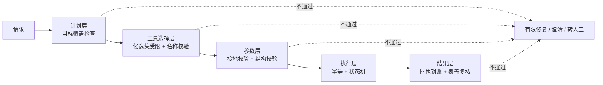

### 10.2 三条设计原则（答题灵魂）

**原则一：把错误拦在"不执行"这一侧，而不是"执行后回滚"这一侧。**

回滚在分布式系统里又贵又不可靠；而"不执行"是免费的。所以能从架构上排除的路径，就不要靠事后补救。

**原则二：不要靠提示词约束，要靠结构性约束。**

| 提示词约束（弱） | 结构性约束（强） |
|---|---|
| "请不要编造订单号" | 参数必须严格等于服务端绑定值，否则拒绝执行 |
| "请只调用已提供的工具" | 候选集只有 6 个，不在集合内就要求澄清 |
| "请不要修改数据" | 写能力不参与检索，模型拿不到入口 |
| "请把金额算准" | 金额只能来自确定性计算能力，模型不产生数值 |

**原则三：程序化检查优先，模型自评只做补充。**

"让模型自己检查自己"是不可靠的——它的错误和它的检查用的是同一套认知。**能用确定性规则检查的，绝不用模型检查。**

### 10.3 具体拦截机制清单（可指认、可背诵）

| # | 机制 | 拦什么 |
|---|---|---|
| 1 | **数值不由模型产生** | 金额、定额、功率等只能来自确定性计算能力或专业模型 |
| 2 | **参数接地** | 关键标识必须严格等于服务端可信绑定值（不是"相似"，是"严格等于"） |
| 3 | **字面溯源** | 引用类标识（如操作号、条款号）必须逐字出现在原文中 |
| 4 | **边界匹配** | 编号用词边界匹配，防止 `ORD-100` 误配 `ORD-1000` 这类前缀误命中 |
| 5 | **目标覆盖检查** | 原文中提到的业务要素若未被计划覆盖，**拒绝判定为成功** |
| 6 | **证据时效与版本** | 证据过期或状态版本变化 → 旧提案失效，重新取证 |
| 7 | **合法状态迁移** | 只允许状态机定义的迁移路径 |
| 8 | **回执对账** | 结果不靠推理文字推断，必须与真实回执一致 |
| 9 | **结构漂移检测** | 能力目录的结构哈希与索引元数据不一致 → 拒绝执行 |
| 10 | **预算与循环上限** | 模型请求数、Token、工具数、活动时长联合约束，防无进展循环 |

### 10.4 关键一问："拦住了之后，怎么不只是这一次拦住？"

这是区分"做了检查"和"有治理闭环"的分水岭。答案分四步：

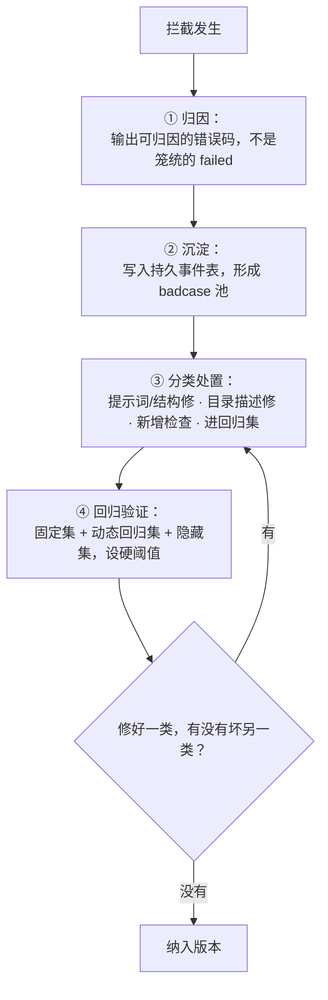

**最重要的一句认知**：

> **"不再犯"的正确预期不是"模型学会了"，而是"系统新增了一条检查"。模型不变，是约束变强了。** 这也是为什么 Agent 工程的核心是**约束设计**，而不是提示词打磨。

**关于"修好一类坏另一类"**：这是提示词调优的经典困境。解法是**把每次拦截样本加入回归集**，每次改动都全量跑一遍——用回归集兜住"其他类不能被破坏"。

### 10.5 三层评测与硬阈值

| 层 | 作用 | 特点 |
|---|---|---|
| 固定测试集 | 版本间可比较 | 长期不变 |
| 动态回归集 | 装"新修好的坑" | 持续增长 |
| **隐藏测试集** | 防过拟合到测试集 | 不参与调优 |

配**硬阈值**：不是"比上一版好就行"，而是"必须达到某个绝对门槛"。

### 10.6 落到你的项目

可以指认的拦截点（这些都不是靠提示词，是代码里的检查）：

| 拦截点 | 拦什么 |
|---|---|
| 计划层覆盖校验 | 原文提到的业务要素未被计划覆盖 → 拒绝判定成功 |
| 编号词边界匹配 | 防止前缀误命中 |
| 工具名与参数契约校验 | 工具名不在候选集 / 参数不合结构 → 拒绝 |
| **参数接地校验** | 关键标识不等于服务端绑定值 → 拒绝 |
| **字面溯源校验** | 引用标识未逐字出现在原文 → 拒绝 |
| 结构漂移检测 | 目录结构或元数据漂移 → 拒绝执行 |
| 回执对账 | 超时不能推断为"未写入" |

另外还有一个很能体现"检查而不只是防御"的例子：**参数注入探针**——40 个工具 × 5 类参数注入，全部被拒绝。这是**主动去找漏洞**，而不是等线上出事。

## 第二部分：面试示例回答

> **背诵版（约 120 秒）**

我把幻觉分成四层，每层用不同武器，最后讲治理闭环。

**第一层，事实层——编造条款、编造金额。** 这一层靠检索证据，但关键不只是"检索到"，而是**证据要带来源、时间、版本，并且生成后要校验引用**。所以我的做法是检索证据带上时效和版本，答案必须能引到具体出处；证据过期就重新取证。

**第二层，工具选择层——选错工具或幻造工具名。** 我的做法是**候选集受限**：模型只能在一个很小的授权候选集合里选，工具名不在集合内就要求澄清，而不是让它自由生成。这比提示词里写"请只调用已提供的工具"可靠得多——**不是靠它自觉，是它根本没有别的选项**。

**第三层，参数层——编造订单号、算错金额。** 这一层我认为最关键，有两个原则。**一，数值不由模型产生**——金额、定额这类数字只能来自确定性计算能力，模型只负责解释。**二，参数接地**——关键标识必须**严格等于**服务端可信绑定值，不是"相似"；引用类标识必须逐字出现在原文里；编号还要做词边界匹配，防止短编号误命中长编号。这三点都是代码里的检查，不是提示词要求。

**第四层，结果解释层——把部分完成说成全部完成。** 我用两个机制：**目标覆盖检查**——原文里提到的业务要素如果没有被执行计划覆盖，我直接拒绝判定为成功，而不是"完成了大部分就给过"；还有**回执对账**——最终结果不靠推理文字推断，必须与真实回执一致，超时**不能**推断成"没写进去"。

**然后讲"拦住之后怎么不只是这一次拦住"**，我觉得这才是真正的考点。分四步：**一，可归因**——拦截必须输出具体的错误码，不能只记一个笼统的失败，否则无法治理；**二，沉淀**——写入持久事件表形成 badcase 池；**三，分类处置**——是提示词问题就修提示词，是能力描述问题就修目录，是规则缺口就新增检查，同时**把样本加进回归集**；**四，回归验证**——每次改动全量跑固定集加动态回归集，设硬阈值，专门防止"修好一类、坏另一类"。

**最后说一个我特别想强调的认知**：**"不再犯"的正确预期不是"模型学会了"，而是"系统新增了一条检查"——模型不变，是约束变强了。** 所以我认为 Agent 工程的核心工作是**约束设计**，不是提示词打磨。我项目里最能体现这一点的是一个主动探测机制：我用 40 个工具 × 5 类参数注入做探针测试，结果发现有一批只读工具会**静默接受多余的参数**——它没有造成越权，但违背了公布的契约。修复方式是在注册时强制严格模式。**契约声明和运行时强制是两件事，安全边界必须落在运行时。**

---

# 附录 A｜十题速记卡（考前 10 分钟看这一页）

| 题 | 一句话核心答案 | 必须说出的关键术语 |
|---|---|---|
| Q1 图与状态 | 图的灵魂是**持久化执行 + 可重放**；interrupt 是一等公民；副作用必须放在 interrupt 之后 | 状态合并规则、条件边、检查点、线程标识、打断点续跑 |
| Q2 选型 | 看控制流不看不功能：需要循环/分支/中断恢复/共享状态才上图 | 高层入口跑在图运行时之上、四个控制流语义 |
| Q3 Skill 粒度 | 用**契约七要素**判断粒度；元数据写模糊等于技能不存在 | 输入输出结构、前置条件、副作用、权限、失败模式、补偿、渐进式加载 |
| Q4 路由规模 | 先区分干扰项与近义项；**先崩的是元数据治理不是检索算法** | 效果唯一化、负向描述、分层路由、消歧协议 |
| Q5 图纸 RAG | 信息分文字/符号/**拓扑**三层；**多粒度并存**不选一个 | 图层解析、拓扑重建、子图级向量化、全局锚点、拓扑正确率 |
| Q6 时序模型 | **模型算数，语言模型编排与解释**；三种失败分别处理 | 采样率假设、模型/特征版本、降级到确定性算法、缓存键含版本 |
| Q7 算法库 | 横向按能力分层、纵向按领域切分、底座是统一契约 | 契约七要素、结构化错误回传、加版本后缀不改签名 |
| Q8 无幂等写入 | 先定**可接受的失败语义**；最有效一招是**绝对量替代相对量** | 写意图表、独立通道验证、写前读、陈旧指令覆盖 |
| Q9 评测 | 用严格成功 + 族均衡率 + 聚类 bootstrap；含 0 = 证据不足不是无效 | 样本不独立、簇重采样、配对差值、区间下界高于目标 |
| Q10 幻觉拦截 | 分四层拦截；**拦在"不执行"这一侧**；不再犯 = 新增检查不是模型学会 | 参数接地、字面溯源、目标覆盖、可归因错误码、回归集 |

---

# 附录 B｜本项目口径速查（**防止说错，这是红线**）

面试时最危险的不是答不出，是**说错自己的数据**。以下口径必须照说。

## B1. 可以说、且必须带条件说的

| 维度 | 数字 | 必须同时说的边界 |
|---|---|---|
| 失败恢复 | 方案 144/144 vs 对照 48/144，+66.67pp，区间 [33.33, 100] | family 数较少；仅覆盖登记故障族 |
| 时效记忆 | 方案 180/180 vs 向量历史基线 62/180；差值按 **family 均衡口径 +75.64pp**，区间 [55.13, 92.31]（基线均衡率 24.36%，任务级 34.44%，**两口径不可互推**） | 无独立人工盲审；条件 Token 仅覆盖主集 34.44%（62 对，与任务级成功率同源）；不含离线 embedding 成本 |
| 规划消融 | 159/180 vs 139/180，**+8.56pp，区间 [1.03, 17.59]，不含 0** | 这是**唯一获统计支持**的规划结论 |
| 工具路由 | 1000 项目录两组均 150/150，**差值 0pp** | **基线触顶，不能说领先**；1000 目录里只有 40 个可执行工具，其余是干扰描述 |
| 连续运行 | 7200.015 秒、120/120 通过、0 失败、峰值 2.235 GiB | 单宿主；峰值不含 benchmark 容器与其他项目 |
| 过程接管 | 同宿主 Worker 接管约 30.19 秒 | **不等于跨故障域高可用** |
| 测试 | 后端 293 项在 Windows 与 Docker Linux 均通过 | 本机验证不等于远端 CI 已执行 |
| 参数注入探针 | 40 工具 × 5 类全部被拒绝 | 修复前有 37 个只读工具静默接受多余参数 |

## B2. 绝对不能说（说了就是硬伤）

| ❌ 不能说 | ✅ 应该说 |
|---|---|
| "我的路由准确率比基线高" | "两组都是满分，基线触顶，只能说候选池放大 25 倍没有退化" |
| "规划能力提升 9.14pp，效果显著" | "点估计达到目标，但 95% 区间含 0，不能声称总体正效应" |
| "已验证 1000 个工具都能调用" | "1000 项目录里只有 40 个可执行工具，其余是路由实验的干扰项" |
| "达到了高可用" | "单宿主部署；同宿主进程接管不等于跨故障域高可用" |
| "支持 PDF/Word 文档入库" | "当前只支持纯文本，实际入库约 4MB 文本以内" |
| "上线了真实商家系统" | "商家侧是可审计的模拟系统，不是已接入真实电商平台" |
| "准确率 100%" | "在冻结的模拟场景上达到严格成功满分，不能外推真实生产" |
| "我有图纸 RAG 经验" | "我做过的是纯文本知识库；图纸这条线我研究过技术路线" |

## B3. 三个"自曝边界"的标准句式（主动说，反而加分）

1. **关于基线触顶**："这个实验我只能说没有退化——因为基线已经打满样本上限，差值 0，所以我说不出'更准'。"
2. **关于区间含 0**："点估计达标但区间含 0，所以我报告里写的是'未获统计支持'，不写'提升 9pp'。"
3. **关于领域差距**："我做的是电商售后，贵司是电气机械。骨架我熟——编排、能力封装、检索、受控写入、评测；但领域知识我需要补，尤其是图纸的符号体系和时序信号的物理含义。"

---

# 附录 C｜通用加分句式库（背下来直接套）

## C1. 展示"把约束下沉到架构"（最高频加分点）

> "这里我不是靠提示词让他别犯错，而是**架构上让他犯不了**——写能力根本不参与检索，模型拿不到入口。"

> "我把错误**拦在'不执行'这一侧，而不是'执行后回滚'这一侧**。回滚在分布式系统里又贵又不可靠，而不执行是免费的。"

## C2. 展示"契约思维"

> "我把能力拆成**输入结构、输出结构、前置条件、副作用、权限、失败模式、补偿**七个字段。**七个里三个以上说不清，说明这块流程还没想明白，不该包成能力。**"

## C3. 展示"引用最新版本"

> "旧的链式写法和旧 Agent 执行器已经废弃、被移到历史包里了，新项目应该用标准 Agent 入口或显式状态图。所以我看到 2024 年之前的教程会直接跳过。"

> "高层 Agent 入口本身就跑在图运行时之上，所以**'用不用图'和'用不用高层封装'是两个独立问题**。"

## C4. 展示"量化与统计素养"

> "**'达到目标'和'统计支持'是两件事。** 我的主指标点估计达标但区间含 0，所以结论是未获支持；真正获支持的是消融实验。"

> "比'区间是否含 0'更强的是看**区间下界是否高于预登记目标**。"

## C5. 展示"承认边界"（面试官最看重的品质之一）

> "这个数字必须带一个边界一起说，否则就是误导。"

> "我主动说一个反面的数据：在这个规模上我的**成本和延迟反而比基线差**——Token 更多、中位延迟更高。所以我认为规模问题的第一解不是更复杂的检索，是**把候选空间结构化**。"

## C6. 回答"你没做过这个领域"时的万能结构

> "这四点我按**可迁移 / 需补齐**分开说：可迁移的是骨架（编排、契约、检索、受控写入、评测）；需补齐的是领域（符号体系、物理含义、机理约束）。**我的判断是，骨架决定系统能不能上线，领域决定系统好不好用，而骨架的迁移成本远低于领域。**"

---

# 附录 D｜资料来源

## D1. IMA 知识库（ID 7491386785933337）

知识库「【Agent+大模型+python+React】」，共 164 项。本次直接引用的高价值条目：

| 条目 | 用途 |
|---|---|
| 《Building Effective Agents》（Anthropic 官方 PDF + 中文版） | Agent 工作流范式、成本与延迟取舍 |
| Agent 项目分析 L1-编排与运行时：LangGraph 架构指南 | 状态图、执行引擎、检查点、时间旅行、反模式 |
| Agent 项目分析 L4-生产基础设施：MCP 架构指南 | 协议边界与安全 |
| Lang 全家桶速成手册 | 组件定位与选型表 |
| 知识点 / 题库：ai-agent-interview-guide、agent-interview-100 | 工具安全分级、工具选择规模演进、RAG 全链路、多模态 |
| 2026 大厂 Agent 开发与大模型应用开发岗面试真题集 | 真题分布与各厂风格（本题集的提问来源） |
| 大模型应用开发与 Agent 开发工程师 JD 调研报告 | 岗位能力画像与 2026 趋势 |
| 新 Agent 大模型应用开发工程师岗位技术面试考点表 | 考频与重要度排序 |
| 《多模态大模型：技术原理与实战》《基于大模型的 RAG 应用开发与优化》 | 多模态与 RAG 工程细节 |

## D2. 联网检索（2026-10-16）

| 主题 | 关键结论来源 |
|---|---|
| LangGraph 检查点与人工介入最佳实践 | 官方持久化/中断语义、副作用重放风险的多篇工程实践总结 |
| Chain / Agent / Graph 选型 | LangChain v1 迁移说明：标准 Agent 入口跑在图运行时之上；旧执行器已废弃 |
| Skill 渐进式加载与工程化 | Skill 规范三层加载（元数据/SKILL.md/资源）、契约七要素、自动化生成反模式、挂载数量与成功率关系 |
| 工业图纸多模态 RAG | 电力设计知识库的图层解析与拓扑重建实践；制造业多模态 RAG 五段管线（文本覆盖率约 40–50% vs 90–95%）；P&ID/电气图纸的检测+识别+图谱生成研究 |
| 工业时序模型与 Agent 编排 | 工业 Data Agent 实践：专家经验沉淀为技能、时序/机理/预测模型封装为工具由大模型调度；预测性维护技能包的时域+频域+模型预测四层递进 |

## D3. 使用提醒

- **本材料中的数字与结论均来自你的项目文档**，引用时请遵守附录 B 的口径红线。
- **Q5、Q6、Q7 是你项目的真实缺口**，答题策略是"承认现状 + 展示技术路线 + 给出可落地方案"，不要包装成已交付。
- 建议**每周重读一次第一部分**，直到能用自己的话讲出每题的"为什么"，再进入第二部分背诵。

